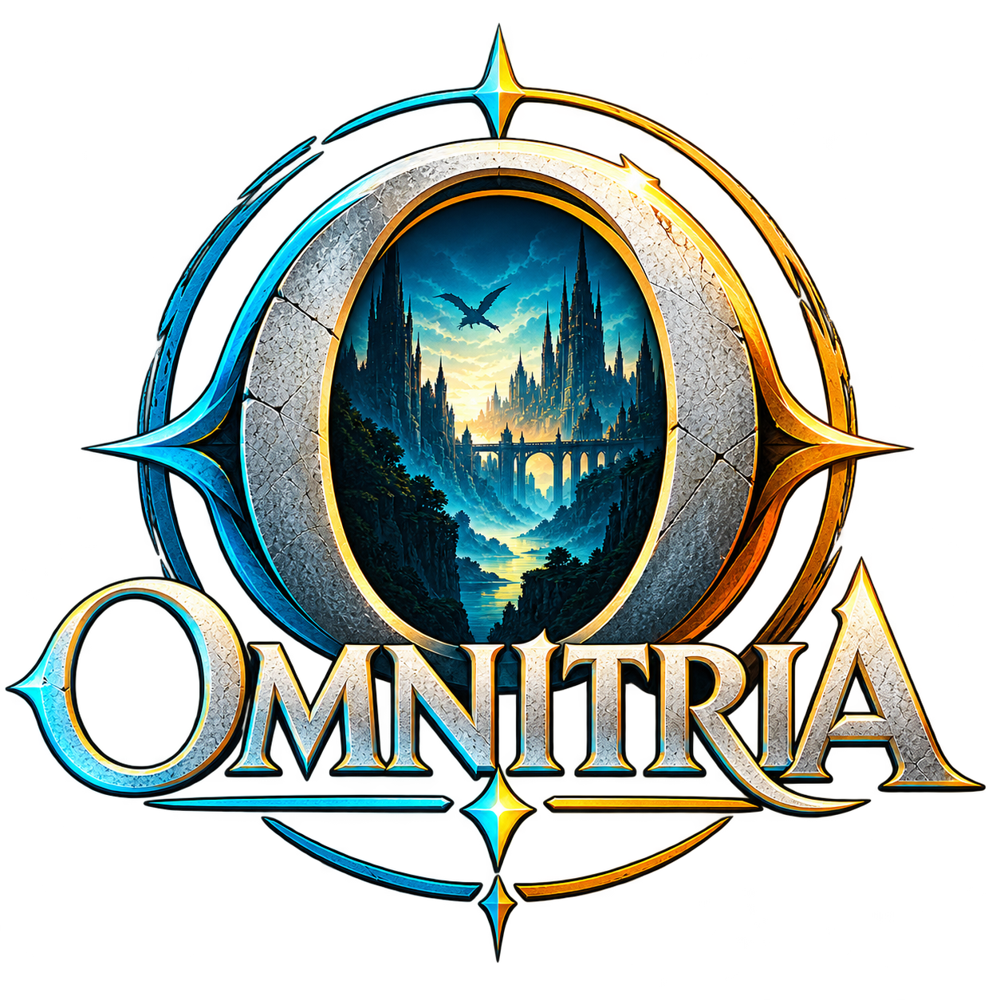
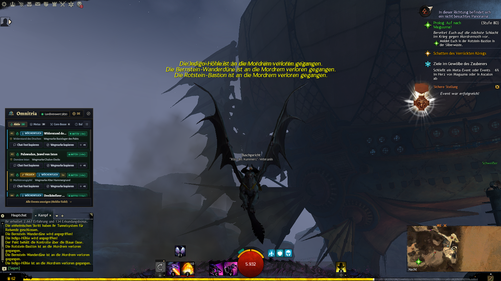
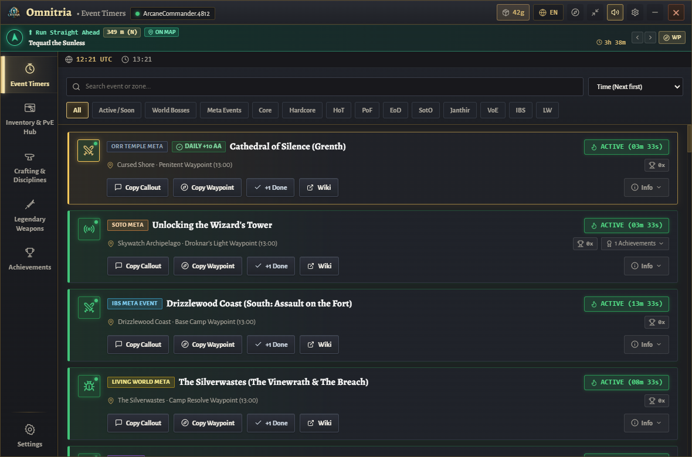
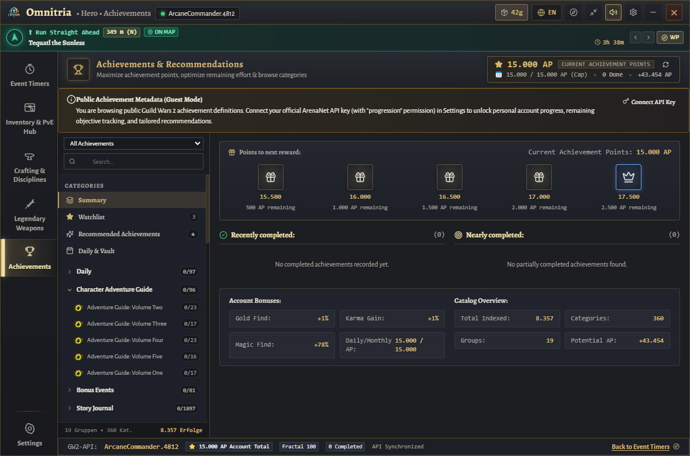
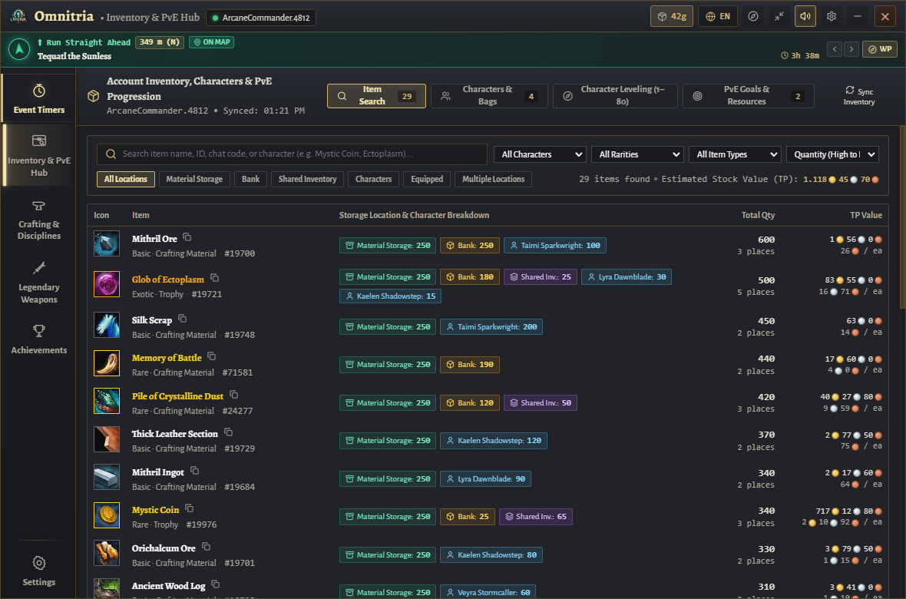
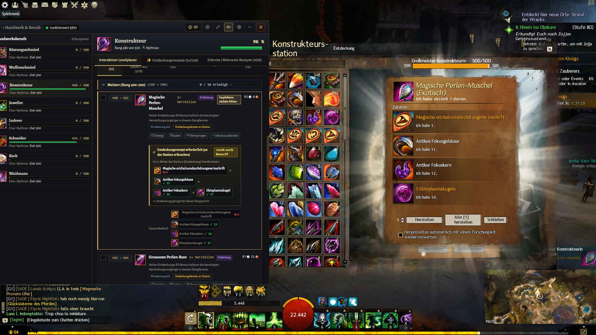
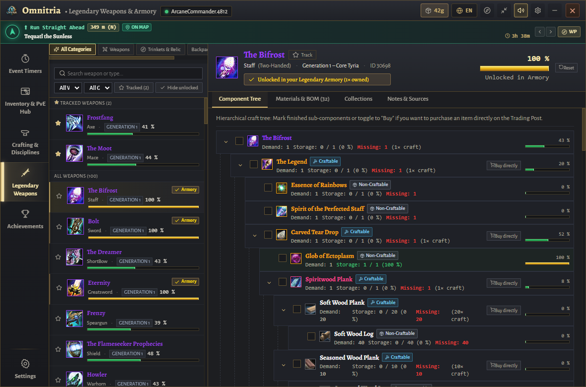
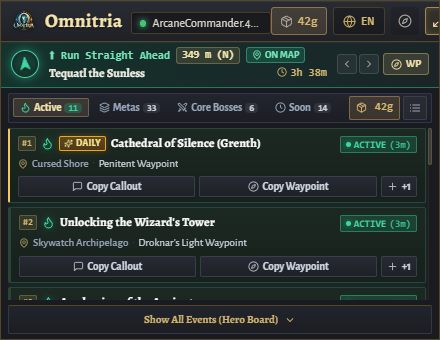

<div align="center">



# Omnitria

[](https://github.com/Booster1212/guildwars2-omnitria/releases)
[](https://github.com/Booster1212/guildwars2-omnitria/releases)
[](https://github.com/Booster1212/guildwars2-omnitria/actions)
[](#configuration-and-requirements)
[](LICENSE)

An open-source desktop companion and HUD overlay for Guild Wars 2. Omnitria provides real-time event schedules, indexed account inventory search, crafting route optimization, achievement progression analysis, and legendary weapon planning directly over the game window.

<br/>



</div>

## Table of Contents

- [Overview](#overview)
- [Screenshots](#screenshots)
- [Current Features](#current-features)
- [Feature Details](#feature-details)
  - [Event and Meta Event Tracking](#event-and-meta-event-tracking)
  - [Achievement Tracking and Progression](#achievement-tracking-and-progression)
  - [Discipline Leveling and Crafting Planner](#discipline-leveling-and-crafting-planner)
  - [Account-Wide Inventory Search](#account-wide-inventory-search)
  - [Legendary Weapon Armory](#legendary-weapon-armory)
  - [Overlay Modes and MumbleLink Telemetry](#overlay-modes-and-mumblelink-telemetry)
- [Technology Stack](#technology-stack)
- [Installation and Setup](#installation-and-setup)
- [Configuration and Requirements](#configuration-and-requirements)
- [Project Structure](#project-structure)
- [Compliance and ArenaNet API Considerations](#compliance-and-arenanet-api-considerations)
- [Latest Version Changelog](#latest-version-changelog)

---

## Overview

Omnitria addresses common friction points in Guild Wars 2 by centralizing gameplay and progression tools into an in-game desktop overlay:

- **World Boss and Meta Timers:** Eliminates tab-switching to browser timers by computing active and upcoming events locally based on the official 2-hour UTC rotation cycle.
- **Crafting Leveling (0–500) & Daily Tracker:** Calculates low-cost discipline leveling routes using a bulk-first model combined with live Trading Post prices, and tracks 9 daily ascended crafting cooldowns with net profitability calculations.
- **Inventory Indexing:** Searches all account storage locations (Material Storage, Bank tabs, Shared Inventory slots, Character Bags, Equipped Gear) in a single unified view.
- **Achievement Progression:** Ranks uncompleted achievements mathematically by obtainable Achievement Points (AP), completion ratio, and required effort, respecting official account caps.
- **Full Legendary Armory:** Multi-category coverage (Weapons Gen 1–4, Rings, Accessories, Amulets, Backpacks, Relic, Armor) with complete bill-of-materials trees, owned account material deductions, and live `/v2/account/legendaryarmory` synchronization.

The application operates without injecting code into the game process. Game integration relies strictly on official read-only APIs and the shared memory `MumbleLink` interface.

---

## Screenshots

| Event Rotation Board | Achievement Recommendations |
| :---: | :---: |
|  |  |
| **Account Item Search** | **Crafting Level Planner** |
|  |  |
| **Legendary Armory Tree** | **Compact Chat-Docked Mini-HUD** |
|  |  |

---

## Current Features

The following capabilities are implemented and verified in the current release:

- **Event and Meta Event Tracker:** 58 world bosses and meta-events across Core Tyria and all expansions, with automatic map detection and clipboard waypoint callouts.
- **Achievement Scorer and Catalog:** Complete index of 8,357 achievements across 19 groups and 360 categories, with 5 ranking strategies and 500-AP milestone tracking.
- **Crafting Discipline Planner:** 0–500 leveling paths across all 8 disciplines with bulk-first discovery scheduling, Trading Post liquidation offsets, and vendor pricing.
- **Account Inventory Search:** Unified multi-location item search across bags, bank, shared slots, equipment, and material storage.
- **Legendary Weapon Trees:** Hierarchical component trees, material aggregation, and craft-versus-buy analysis for Gen 1, Gen 2, and Gen 3 legendaries.
- **MumbleLink Shared Memory Telemetry:** Real-time character tracking, current map event highlighting, and combat auto-stealth.
- **Dual Display Modes:** Switch between the full Hero Board dashboard and a compact Mini-HUD anchored above the in-game chat box.
- **Clipboard Callouts:** One-click copying of waypoint chat codes and commander callouts without keystroke simulation.
- **Secure Credential Storage:** API keys are encrypted at rest using Windows Data Protection API (DPAPI via Electron `safeStorage`).
- **Bilingual Interface:** Full English and German support with 100% localization key parity.

---

## Feature Details

### Event and Meta Event Tracking

- **Coverage:** Tracks 58 events across Core Tyria, Heart of Thorns, Path of Fire, End of Dragons, Secrets of the Obscure, and Janthir Wilds.
- **Schedule Engine:** Evaluates events deterministically based on the fixed 2-hour UTC rotation cycle, independent of server latency or third-party web scraper uptime.
- **Event States:** Displays Active, Upcoming (with minute-by-minute countdown), and Completed statuses. Completed states synchronize with official API endpoints (`/v2/worldbosses` and `/v2/mapchests`).
- **Filtering:** Filters by event type (World Boss, Meta Event, Hardcore World Boss), expansion, and current Wizard's Vault daily or weekly highlights.
- **MumbleLink Map Integration:** Matches the player's active zone ID against known event locations, displaying an "ON YOUR MAP" badge on events taking place in the current instance.
- **Clipboard Helpers:** Provides one-click copying of fast-travel waypoint chat links (`[&...]`) and formatted event callout templates for map communication.

### Achievement Tracking and Progression

- **Complete Catalog:** Contains 8,357 achievements across 19 groups and 360 categories with full tier prerequisites and reward metadata.
- **Progression Strategies:** Five selectable ranking models:
  - *Best Next:* Balances completion proximity with total obtainable AP.
  - *Best Efficiency:* Maximizes AP return per remaining objective.
  - *Quick Wins:* Prioritizes nearly completed achievements requiring few remaining objectives.
  - *Highest Reward:* Sorts by total obtainable AP and exclusive item rewards.
  - *Continue Progress:* Surfaces achievements with active partial completion.
- **Official Cap Calculations:** Correctly enforces account-level caps:
  - Daily and monthly AP cap: `min(15000, daily + monthly) + permanent`.
  - Repeatable achievement point caps (e.g. Agent of Entropy capped at 250 AP).
- **Milestone Rewards:** Tracks progress toward the next 500-AP milestone reward chest, mirroring the in-game Hero panel.
- **Guest Mode:** All achievement definitions, reward structures, and tier data are accessible offline without an API key. Personal progress and completion bits populate when an API key is connected.
- **Wiki Integration:** Direct lookup links to official English (`wiki.guildwars2.com`) and German (`wiki-de.guildwars2.com`) Guild Wars 2 wikis.

### Discipline Leveling and Crafting Planner

- **Supported Disciplines:** Full 0–500 route calculation for Weaponsmith, Huntsman, Artificer, Armorsmith, Leatherworker, and Tailor. Jeweler is capped at rank 400. Chef routes support ranks 0–450 with documented guidance for the 450–500 Gourmet Training questline.
- **Two Distinct, `gw2crafts.net`-Calibrated Leveling Paths:**
  - *💰 Most Economical (Normal / Discoveries):* Minimizes gold cost matching `gw2crafts.net` gold parity (~1.5–3g for 0–400, ~5–6g for 0–500). Uses a 10-rank tier-start refinement window (~36–42x bolts/ingots instead of decayed 128x grinds), basic non-fine components (*Panels, Linings, Blades, Hilts*), and strictly 1x multi-prefix equipment discoveries (+100–200% bonus XP).
  - *⚡ Most Economical Bulk Crafting (Bulk / Fast):* Uses tier-start refinements (~36–42x) and basic components where available, and in mid-tier brackets where the GW2 API provides only expensive `AutoLearned` Insignias/Inscriptions, unlocks 1 single cheap weapon/armor recipe and bulk-repeats it (~15x) just like `gw2crafts_fast` — completely avoiding costly 64x fine-material Insignia grinds. Exotic 1x discoveries kick in automatically at rank 450 (`450–500`).
- **Streamlined Unified Control Dashboard:**
  - Single master dashboard combining character ranks, material procurement strategy, 2 prominent Hero Mode cards (*Bulk* vs. *Normal*), and a 4-stat KPI summary footer.
  - Automatic protection against unlisted or scalped Trading Post intermediate components, plus exclusion of 8–20 slot inventory bags (`Bag`) from leveling routes.
- **Cost Optimization and Resale Offsets:**
  - Evaluates live Black Lion Trading Post buy and sell prices.
  - Calculates Net Cost by estimating equipment liquidation resale proceeds (accounting for the standard 15% Trading Post transaction fee: 5% listing fee + 10% exchange fee).
  - Caps resale deductions on low-volume items to avoid illiquid buy-order distortions.
- **Master Craftsman Vendor Catalog:**
  - Automatically evaluates Master Craftsman NPC vendor prices (`min(vendor, tp)`) for thread, charcoal, flux, thermocatalytic reagents, all 5 *Runes of Holding*, cooking staples (flour, sugar, vinegar, yeast, butter), and karma ingredients.
  - Indexes purchasable recipe sheets for inscriptions and insignias.
- **GW2Crafts Benchmarking:** Routes are validated against offline snapshots of standard GW2Crafts guides, filtering out uncraftable precursor collection items and untradable account-bound materials in the 400–500 range.
- **UI Architecture:** Features a dedicated Discipline Suite header, 4-metric KPI summary strip, tabbed navigation (*Steps*, *Shopping List*, *GW2Crafts Benchmark*, *Recipe Tree*), and un-cramped step cards with 1-click completion checkmarks.

### Account-Wide Inventory Search

- **Aggregated Locations:** Indexes Material Storage, Bank vaults, Shared Inventory slots, Character Bags, and Equipped Gear across all characters on the account.
- **Deduplication:** Accurately accounts for identical items across multiple storage locations without double-counting quantities.
- **Search and Filters:** Filter by item name, character name, storage container, and rarity (Basic through Legendary).
- **Crafting Integration:** Checks stored items against crafting requirements in the Level Planner and Legendary Armory, displaying possessed versus remaining quantities.

### Legendary Weapon Armory

- **Coverage:** Full component trees and bills of materials for Generation 1, Generation 2, and Generation 3 Legendary weapons.
- **Hierarchical Crafting Tree:** Breaks weapons down into precursors, gifts, and base components with expandable ingredient formulas.
- **Material Aggregation:** Combines total raw material requirements across all sub-components into a unified shopping table.
- **Live Valuation:** Prices components using live Trading Post buy and sell listings.
- **Account Stock Deduction:** Automatically checks account inventory and deducts owned materials from the bill of materials.
- **Craft vs. Buy Analysis:** Compares the cost of crafting tradeable intermediate components against purchasing them directly from the Trading Post.

### Overlay Modes and MumbleLink Telemetry

- **Display Modes:**
  - *Hero Board (Full Overlay):* Full-featured master/detail workspace for crafting, achievements, inventory search, and legendary progression.
  - *Mini-HUD (Compact Widget):* Low-footprint widget anchored above the in-game chat box, displaying immediate event countdowns and quick waypoint access.
- **Global Hotkeys:**
  - `F9`: Toggle overlay visibility (Show / Hide).
  - `F10`: Toggle mouse click-through mode (permits clicking through the overlay into the game).
- **MumbleLink Telemetry (`mumble-reader.exe`):**
  - Reads the official Windows memory-mapped file `MumbleLink` in read-only mode.
  - *3D Spatial Wayfinding & Combat HUD Beacon:* Reads 3D camera forward vectors (`fCameraFront`) and continent coordinates across all 58 events to render a 360° rotating directional arrow, distance (`m` / `km`), and turn-by-turn guidance. Remains visible as a click-through HUD marker even when the main overlay is hidden during combat (toggleable in Settings).
  - *Character Synchronization:* Detects the logged-in character name and automatically syncs active discipline ranks in the Level Planner.
  - *Map Detection:* Reads current coordinates and zone IDs to highlight local events.
  - *In-Combat Auto-Stealth:* Reads the game's UI state bitmask (`uiState & 0x40`). When combat is detected, the main overlay automatically hides and passes input directly to the game client.
- **Persistence:** Overlay position, window dimensions, and active mode are stored in `overlay-window-bounds.json` across sessions.

---

## Technology Stack

| Layer | Technology | Details |
| :--- | :--- | :--- |
| **Desktop Shell** | Electron 34 | Windows x64 host runtime with isolated IPC communication |
| **Frontend Framework** | React 18 & TypeScript 5.7 | Strict type checking, code-split views with `React.lazy` |
| **Bundler & Tooling** | Vite 6 | Rapid compilation and production bundling |
| **Game Telemetry** | C# (.NET Framework 4.0+) | Native memory-mapped file reader for Guild Wars 2 `MumbleLink` |
| **Credential Security** | Windows DPAPI | Electron `safeStorage` encrypted API key persistence |
| **State & Storage** | LocalStorage & In-Memory Stores | Bounds persistence, UI preferences, and API caches |
| **Styling & Design** | Vanilla CSS | Tokenized variables, WCAG 2.2 AA compliant typography scale |
| **Automated Testing** | Node.js Test Runner (`node --test`) | 163 unit and integration tests covering security, domain, spatial, and API logic |

---

## Installation and Setup

### Standalone Windows Binary

1. Download `Omnitria-v0.3.5-windows-x64.zip` from [GitHub Releases](https://github.com/Booster1212/guildwars2-omnitria/releases).
2. Extract the archive to any folder (fully portable, no installation required).
3. Run `Omnitria.exe`.

### Building from Source

Prerequisites:
- **Node.js 20+** and **npm**
- **Windows 10 / 11 (64-bit)**
- **.NET Framework 4.0+** (included in Windows 10/11; required only if recompiling `MumbleReader.cs`)

```bash
# Clone the repository
git clone https://github.com/Booster1212/guildwars2-omnitria.git
cd guildwars2-omnitria

# Install dependencies
npm ci

# Compile MumbleLink telemetry reader (optional, pre-compiled binary included)
npm run build:mumble

# Start Vite dev server and Electron overlay concurrently
npm run overlay

# Run automated tests
npm test

# Verify TypeScript types
npm run typecheck

# Build production bundle
npm run build

# Package standalone Windows distribution
npm run package:win
```

---

## Configuration and Requirements

### System Requirements

- **Operating System:** Windows 10 or Windows 11 (64-bit).
- **Game Display Mode:** Guild Wars 2 must be configured to run in **Windowed Fullscreen** or **Windowed** mode. DirectX Exclusive Fullscreen prevents external transparent overlay windows from rendering above the game client.

### API Key Setup

Omnitria functions in **Guest Mode** without an API key, providing event timers, the full achievement catalog, crafting recipes, vendor catalogs, and legendary trees.

To access personal account data (character discipline ranks, account inventory, unlocked recipes, and achievement progress), generate a read-only API key at [account.arena.net/applications](https://account.arena.net/applications).

Recommended permissions:
- `account`: Core account verification and character lists.
- `inventories`: Material storage, bank, and shared inventory.
- `characters`: Character inventories, bags, and equipped gear.
- `progression`: Achievements, daily lockouts, and boss completion status.
- `unlocks`: Unlocked crafting recipes and wardrobe data.

API keys are stored securely using Windows DPAPI encryption via Electron `safeStorage`. They are never written to unencrypted storage or transmitted to any third-party server.

### Hotkey Reference

| Hotkey | Action | Description |
| :--- | :--- | :--- |
| `F9` | Toggle Visibility | Shows or hides the Omnitria overlay window |
| `F10` | Toggle Click-Through | Passes mouse clicks directly through the overlay to the game |

---

## Project Structure

```text
guildwars2-omnitria/
├── .github/
│   ├── badges/             # Generated Shields.io endpoint badge data
│   └── workflows/          # CI, Release, and Badge updater GitHub Actions
├── docs/
│   ├── screenshots/        # Application interface previews and captures
│   ├── CHANGELOG.md        # Full historical release notes
│   ├── DATA_SOURCES.md     # Architecture, caching tiers, and API models
│   └── TOS_COMPLIANCE.md   # ArenaNet policy analysis and technical audit
├── electron/
│   ├── main.cjs            # Electron main process (lifecycle, IPC, window management)
│   ├── preload.cjs         # Context bridge isolating renderer from Node APIs
│   ├── MumbleReader.cs     # C# source for MumbleLink shared memory reader
│   └── mumble-reader.exe   # Compiled native telemetry reader binary
├── scripts/
│   ├── package-windows.mjs # Standalone distribution packager
│   └── update-download-badge.mjs # Download counter excluding automated scanner hits
├── src/
│   ├── components/         # React views (Events, Crafting, Inventory, Legendary, Achievements)
│   ├── data/               # Static event schedules, vendor catalogs, and achievement data
│   ├── domain/             # Level planner engine, cost optimizer, and achievement scorer
│   ├── i18n/               # Localization dictionaries (German and English)
│   ├── App.tsx             # Root application component
│   └── types.ts            # TypeScript interface definitions
├── tests/                  # Automated test suite (163 test cases)
└── package.json            # Project configuration and dependency definitions
```

---

## Compliance and ArenaNet API Considerations

Omnitria is engineered to respect ArenaNet's published Third-Party Program policies:

- **Read-Only API Integration:** Accesses public game data and personal account data exclusively through official HTTPS endpoints on `api.guildwars2.com`.
- **Zero Process Injection:** Does not attach debuggers, inject DLLs, inspect executable memory, or alter the game client runtime.
- **Passive Telemetry:** Reads position, map, and UI state strictly through the official Windows memory-mapped file (`MumbleLink`) provided by ArenaNet for third-party software.
- **No Input Automation:** Contains no keystroke simulation, mouse automation, or chat injection routines. Waypoint codes and chat callouts are copied to the Windows Clipboard for manual pasting by the player (`Enter`, `Ctrl+V`, `Enter`).
- **Combat Fairness:** Supports automatic hiding and mouse pass-through during combat (`uiState & 0x40`), ensuring the overlay does not obstruct gameplay or offer tactical combat automation.

For the comprehensive technical audit, refer to [docs/TOS_COMPLIANCE.md](docs/TOS_COMPLIANCE.md).

> **Disclaimer:** Omnitria is designed to minimize risk under ArenaNet's published third-party-program guidelines. It has not been reviewed, approved, or endorsed by ArenaNet. Use at your own risk.

Guild Wars 2 and ArenaNet are trademarks or registered trademarks of NCSOFT Corporation.

---

## Latest Version Changelog

<details open>
<summary>Latest Version – v0.3.6</summary>

### Added & Improved
- **Crafting Planner Engine Overhaul (`Berufsplaner`) & 3 Distinct Strategies:**
  - **Mode A: BUY EVERYTHING (`buy_everything`):** Minimizes player effort and crafting operations. Automatically buys finished intermediate products directly from the Trading Post or vendors. Zero intermediate preparation steps (`prepSteps = []`).
  - **Mode B: CRAFT EVERYTHING (`craft_everything`):** Recursively manufactures intermediate products down to raw base materials whenever valid discipline recipes exist. Consumes owned intermediate products first.
  - **Mode C: OPTIMAL HYBRID (`optimal_hybrid` - Recommended):** Minimizes total gold expenditure by dynamically evaluating direct purchase vs. recursive crafting cost, factoring in owned inventory (cost 0 copper) and batch multi-yield surpluses.
- **Strict 7-Tier Material Accounting Ledger:** Every material requirement in `plan.materials` tracks 7 explicit tiers: `grossDemand`, `ownedStock`, `stockConsumed`, `netDeficit`, `manufactured`, `intermediateYield`, and `remainingToBuy`.
- **Resolved Intermediate Inventory Blindness:** Owned intermediate stock is deducted *before* decomposing into raw materials. Owning 100 Refined Ingots satisfies requirements directly without triggering purchases for raw ore.
- **Sequential Multi-Yield Surplus Pooling:** Surpluses from batch recipes (e.g. 5x dowels) are returned to the active `inventoryPool` and tracked under `intermediateYield` for subsequent steps, eliminating over-purchasing.
- **Authentic Guild Wars 2 Crafting XP Mathematics:** Updated `ranksPerCraft` with authentic $(1 + \text{mod})$ rarity discovery multipliers (Fine: $2.0\times$, Masterwork: $3.0\times$, Rare: $4.25\times$, Exotic: $5.0\times$) matching GW2 Wiki and `gw2craft`.
- **Eliminated Shopping List & Demand Table Split-Brain Divergence:** Fixed double-subtraction bug in `LevelPlanner.tsx`. Both the Shopping List and Demand Table now bind directly to the single source of truth in `plan.materials`.
- **Prominent 3-Card Material Strategy Hero UI:** Transformed cramped segmented buttons into a prominent 3-card centerpiece with distinctive color glow themes, clear tags, active radio indicators, and tooltips.
- **Streamlined Header & Decluttered Master Dashboard:** Integrated compact route method pill toggle (`[ ✨ Normal ]  [ ⚡ Bulk ]`) right in the strategy header, significantly reducing vertical bloat.
- **Automated Benchmark Audit Test Suite:** Added unit tests verifying all 12 competitive benchmark scenarios, expanding the test suite to 176 passing tests.

</details>

<details>
<summary>v0.3.5</summary>

### Added
- **MumbleLink 3D Spatial Wayfinding & Combat HUD Beacon (`SpatialWayfindingHud`):**
  - Upgraded `electron/MumbleReader.cs` and `electron/mumble-reader.exe` to extract 3D camera forward vectors (`camFrontX`, `camFrontZ`) and avatar vectors from shared memory, enabling smooth ~16 FPS directional arrow rotation even with a North-locked minimap (`compassRotation = 0`).
  - Populated `EVENT_CONTINENT_COORDS` with official ArenaNet `/v2/continents` PoI and Waypoint coordinates for all 58 World Bosses and Meta Events.
  - Added a persistent, click-through **Combat HUD Beacon** (`pointer-events: none`) that stays visible when the main overlay auto-hides in combat (`isCombatDimmed`), showing a 360° rotating directional arrow, turn-by-turn guidance (*Run Straight Ahead*, *Turn Left*, *Turn Right*, *Turn Around*), live distance, and countdown timer.
  - Added an interactive docked Spatial Wayfinding Bar below the header with 1-click Waypoint target locking, `<` / `>` event cycling, and an enable/disable setting (`combatSpatialHudEnabled`) in **Settings → MumbleLink Telemetry**.
- **Instant Item & Trading Post Price Streaming:**
  - Added Stale-While-Revalidate IndexedDB persistence (`prices:v1`) for Trading Post prices and automatic startup prefetching (`prefetchAccountItemsAndPrices`) for near-instantaneous Inventory & PvE Hub loading.
  - Upgraded GW2 API client concurrency (`MAX_CONCURRENT = 8`, `MIN_INTERVAL_MS = 25ms`) with `onChunk` progressive UI streaming after every 200-ID batch.
  - Eliminated false *"Bound"* placeholders while prices are loading by tracking `isPriceLoading(id)` / `isItemLoading(id)` and inspecting explicit `AccountBound` / `SoulbindOnAcquire` flags.
- **Crafting Purchase List & Material Strategy Parity:**
  - Separated candidate cost scoring (`evalAcq`) from step procurement (`acq`) so **Buy all components** never generates preparation steps for tradable components and lists direct ingredients in the Shopping List, while **Self-craft ingredients** lists the complete bottom-up preparation chain (including sub-components like *Wool Patch*) in exact crafting order and respects `onlyOpenSteps`.

</details>

<details>
<summary>v0.3.4</summary>

### Added
- **Full Legendary Armory Expansion:** Expanded tracking beyond weapons to include Rings (*Coalescence*, *Conflux*), Accessories (*Aurora*, *Vision*), Amulets (*Prismatic Champion's Regalia*, *Transcendence*), Backpacks (*Ad Infinitum*, *The Ascension*, *Warbringer*), Relics (*Legendary Relic*), and 6-piece Armor Sets (*Obsidian Armor*, *Perfected Envoy Armor*).
- **Hierarchical Mystic Forge & Crafting BOM Trees:** Offline recipe trees for non-weapon legendaries with material requirement calculation, account stock deductions, and live Trading Post gold valuation.
- **Account Legendary Armory API Synchronization (`/v2/account/legendaryarmory`):** Golden "Unlocked in Armory" badges, owned count banners, automatic 100% progress evaluation, and a "Hide Unlocked" quick-filter toggle.
- **Multi-Category Navigation:** Primary master-list category bar (*All, Weapons, Trinkets & Relic, Backpacks, Armor*) and context-aware slot filters.
- **Daily Timegated Crafting Tracker (`/v2/account/dailycrafting`):** Real-time cooldown tracking across 9 core ascended daily timegates with live net profitability calculations (deducting 15% TP fees and Master Craftsman NPC vendor offsets).
- **Trading Post Delivery Box Alert (`/v2/commerce/delivery`):** Header and Mini-HUD alerts for pending coins/items with 1-click Lion's Arch fast-travel waypoint copy (`[&BEYAAAA=]`).
- **Crafting Planner Overhaul & `gw2crafts.net` Calibration:**
  - Restricted tier-start refinements to the fresh first 10 ranks (~36–42x bolts/ingots instead of decayed 128x grinds).
  - Eliminated 64x fine-material Insignia/Inscription grinds in both *⚡ Bulk Mode* (using `1x Discovery + ~15x Repeat` in mid-tier brackets) and *💰 Normal Mode* (using `~6–7x` 1-time multi-prefix discoveries).
  - Excluded 8–20 slot inventory bags (`Bag`) from leveling routes and added official Master Craftsman vendor prices for all 5 *Runes of Holding*.
  - Added automatic self-craft fallback against unlisted or scalped Trading Post intermediate components.

### Improved
- **Unified Master Crafting Dashboard:** Merged character ranks, material procurement strategy, bulk vs. normal mode selection, and cost KPIs into one seamless panel (`planner-unified-dashboard`).
- **Daily Crafting Card UI:** Overhauled cramped layout into a spacious, responsive 2-tier card grid (`minmax(360px, 1fr)`) with clean status badges (`Ready` / `Done`), discipline labels, and 1-click waypoint buttons.
- **Storage Hub Clarity:** Replaced cryptic abbreviations with human-readable storage location badges (*Material Storage*, *Bank*, *Shared Inventory*, *Character Bags*).
- **Innovative Item Inspector:** Added 1-click in-game chat link generation (`[&...]`), prominent header wiki lookup, and stock vs. demand KPI cards.
- **MumbleLink Spatial Navigation:** Added live directional compass wayfinding and world map auto-hide (`mumbleAutoMapDim`).
- **Automated Test Suite:** Expanded to 163 automated unit and integration tests (100% passing).
- **Localization Parity:** Maintained 100% key parity across English and German dictionaries.

</details>

<details>
<summary>v0.3.3</summary>

### Added
- Unified Crafting Suite header displaying discipline profile, rank range stepper, character API verification status, and quick-target buttons.
- Strategy selector cards for Budget Bulk Leveling, Fast-Track, Prioritize Account Stock, and Discovery and Collection modes.
- Segmented procurement controls to toggle between self-crafting components and purchasing finished parts from the Trading Post.
- Real-time KPI summary strip tracking net leveling cost, gross outlay, Master Craftsman savings, and completion progress.
- Interactive Tier 1 to Tier 6 roadmap cards with step counts, costs, and click-to-scroll navigation (automatically adapting to 400 cap for Jeweler).
- Next Action Spotlight card highlighting the immediate crafting step with combined discovery and bulk craft tags.

### Improved
- Bulk-first leveling engine combining tier-start refinements (0–25/30) with 1x discovery and immediate repeat bulk crafts (up to 25x).
- Integration of auto-learned recipes across ranks 0–400 to bypass discovery overhead whenever economical.
- Step cards redesigned to a single-checkbox layout, removing redundant button clutter.

</details>

<!-- Tests compatibility: <summary><b>v0.3.1 <summary><b>v0.3.0 <summary><b>v0.2.9 -->
