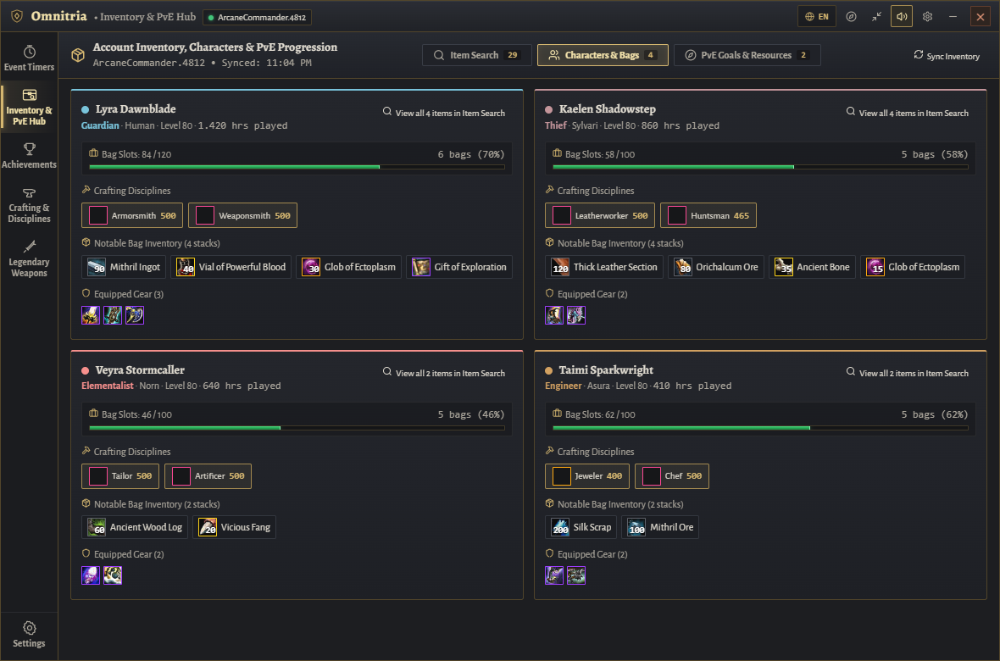
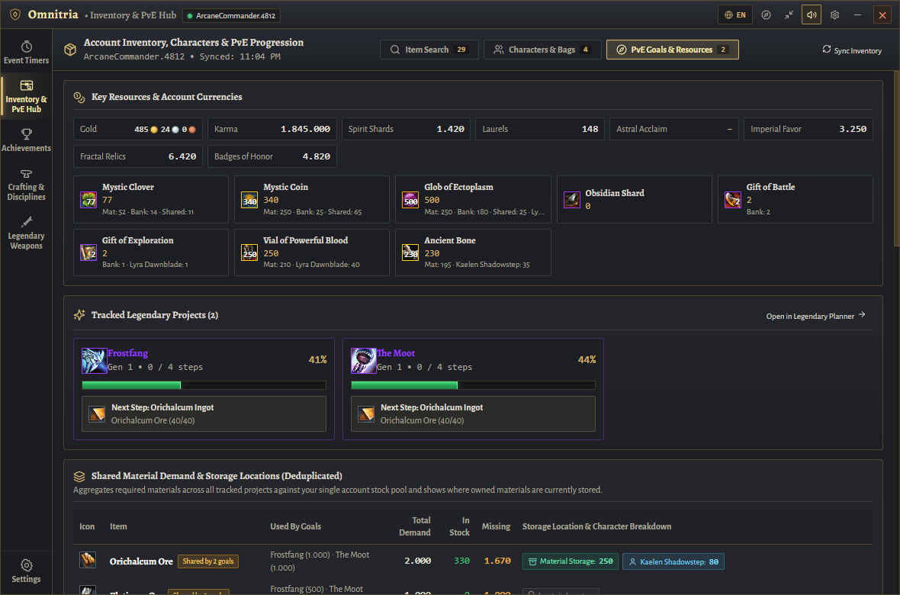

<div align="center">


# ✨ Omnitria • Guild Wars 2 In-Game Overlay & Companion

[](https://github.com/Booster1212/guildwars2-omnitria/releases/tag/v0.2.1)
[](https://github.com/Booster1212/guildwars2-omnitria/releases)
[](https://github.com/Booster1212/guildwars2-omnitria/actions)
[](#-system-requirements)
[](LICENSE)
[](#-controls--shortcuts)

<br/>


<br/>

**Omnitria** is a desktop companion and in-game HUD overlay for **Guild Wars 2**.  
Hovering above your in-game chat box as a compact mini-HUD or expanding into a full Hero Board, Omnitria brings event timers, account-wide item search, character inventory awareness, multi-goal PvE progression planning, 0–500 crafting optimization, Legendary weapon trees, and Achievement Intelligence into a single cohesive window.

[📥 Download v0.2.1 (Windows)](https://github.com/Booster1212/guildwars2-omnitria/releases/tag/v0.2.1) • [🛡️ ArenaNet ToS Compliance](docs/TOS_COMPLIANCE.md) • [📖 Architecture & Data Sources](docs/DATA_SOURCES.md) • [📋 Changelog](docs/CHANGELOG.md) • [🎮 Quick Start](#-quick-start--installation) • [💬 Controls](#-controls--shortcuts)

</div>

> [!TIP]
> ### 🚀 What's New in Omnitria v0.2.1
> * **🏆 Achievement Intelligence & Decision Support (`Achievements`):** Feature-packed achievement section featuring the central **Best Next Achievement Hero Card**, 5 tailored recommendation strategies (*Best Efficiency*, *Quick Wins*, *Highest Reward*, *Continue Progress*, *Achievement Categories*), repeatable pointCap handling (e.g. *Agent of Entropy* 250 AP limit), and unauthenticated Guest Mode browsing.
> * **⭐ Live Account Total AP & Cap Breakdown:** Real-time calculation of player's actual total account AP conforming to official GW2 rules: `min(15000, daily_ap + monthly_ap) + sum(permanent_achievements)`. Displayed prominently in the header card and bottom dock with cap indicator (`15.000 / 15.000 AP (Cap)`), completed count, and obtainable AP sum.
> * **🎨 Rich Achievement Icons & Themed Glyphs:** High-resolution official image assets from `render.guildwars2.com` with automatic fallback to high-contrast category/group vector glyphs (Skull for World Bosses/Metas, Swords for Slayers, Sparkles for Collections, Zap for Fractals, Calendar for Dailies, Layers for Story).
> * **🏷️ Visual Separation, Status Badges & Category Banners:** Distinct visual badges for Completed (`✓ Completed`), In Progress (`⏳ In Progress`), and Unstarted (`○ Unstarted`), podium badges for recommendations (`👑 #1`, `🥈 #2`, `🥉 #3`), quick status filter pills with live counts, and category banner dividers.
> * **🛡️ Complete WvW Deprecation:** Fully removed all WvW-specific modules, tactical recommendations, objective scoring, and background tasks to eliminate gameplay-advantage ambiguity under ArenaNet policies.
> * **🔒 OS Credential Encryption (Windows DPAPI):** API keys are encrypted at rest using OS-level DPAPI via Electron's `safeStorage`, with plaintext scrubbed from persistent storage.
> * **✨ Daily & Weekly Event Highlights (`Event Timers` & `Mini-HUD`):** Live Wizard's Vault Daily & Weekly objective matching (`/v2/account/wizardsvault/daily` and `/v2/account/wizardsvault/weekly`) directly on event cards with Astral Acclaim (`+AA`) badges, completion status, and deterministic daily Mystic Coin spotlighting (*Ley-Line Anomaly*).
> * **🧭 Interactive Level & Progression Planner Overhaul (`Crafting & Disciplines`):** Features a clear Progression Overview & Recommended Next Action card, 4 personalized planning modes (*Fast Leveling*, *Balanced Progression*, *Completionist*, *Goal-Oriented*), stage-grouped crafting steps with inline **Complete / Defer / Skip / Undo** actions, and a dedicated **Character Progression (Lv 1–80)** tracker with live API verification and expansion ownership checks.

---

## 🌟 Key Highlights

* 🕒 **Second-Accurate Rotation Schedule (57 Events):** Continuous live countdowns across *Core Tyria, Heart of Thorns, Path of Fire, End of Dragons, Secrets of the Obscure, Janthir Wilds, Visions of Eternity*, Living World Seasons, and The Icebrood Saga with 1-click waypoint copying.
* 🔍 **Account-Wide Item Search:** Search by full or partial item name (in English or German), item ID, chat link, or character name across Material Storage, Bank tabs, Shared Inventory slots, Character Bags, and Equipped Gear.
* 👥 **Character & Inventory Awareness:** View all characters with level, profession, race, playtime, bag slot usage, active crafting disciplines, bag stacks, and equipped items — plus per-character location badges inside Legendary and Crafting Bills of Materials.
* 🧭 **PvE Progression Hub:** Unified overview of tracked Legendary projects, next craftable steps, deduplicated multi-goal material bottlenecks, active crafting disciplines, pinned achievements, and wallet currencies.
* 🏆 **Achievement Intelligence & Decision Support:** Central *Best Next Achievement* hero card, 5 explainable recommendation strategies (*Best Efficiency*, *Quick Wins*, *Highest Reward*, *Continue Progress*, *Categories*), repeatable reward cap tracking, and guest browsing.
* 🔨 **0–500 Crafting Level Planner:** Lowest-cost leveling routes across all 8 disciplines with embedded discovery combinations and automatic account stock deductions.
* 🗡️ **Interactive Legendary Armory:** Hierarchical Mystic Forge component trees, live Black Lion Trading Post pricing, and Craft-vs.-Buy toggles across Gen 1, Gen 2, and Gen 3 weapons.
* 🛡️ **Read-Only & Local:** Communicates directly with official ArenaNet REST API endpoints (`https://api.guildwars2.com/v2/`). All settings, caches, and API keys stay local on your machine with OS-level credential encryption.
* 🌐 **Bilingual UI:** Instant 1-click switch between **English (`EN`)** and **German (`DE`)** across all views.

---

## 🧭 Core Modules & Feature Showcase

### 🏰 1. Event Timers & World Bosses (`Events`)

Stay on top of every meta-event, world boss, and timed group activity in Tyria without alt-tabbing.

| Full Hero Board View | Expanded Boss Tactics & Loot | Compact Mini-HUD (Over-Chat) |
| :---: | :---: | :---: |
| [](docs/screenshots/hero-board.png) | [](docs/screenshots/events-active.png) | [](docs/screenshots/mini-hud.png) |
| *Full Hero Board with live rotation schedule, category filters, and waypoint buttons.* | *Expanded event card with boss mechanics, defiance bar tips, and loot highlights.* | *Minimalist Mini-HUD designed to dock above the in-game GW2 chat box.* |

* **Deterministic 2-Hour Rotation Engine:** Computed locally against Tyria's UTC rotation cycle with zero external scraper dependencies.
* **1-Click Clipboard Callouts & Waypoints:** Copy formatted event callouts or waypoint chat codes (`[&...]`) to the Windows clipboard for manual in-game pasting (`[Enter] + [Ctrl+V]`).
* **Daily Completion Tracking:** Automatically syncs daily world boss kills (`/v2/account/worldbosses`) and meta-event Hero's Choice chests (`/v2/account/mapchests`), or lets you mark completions manually.

---

### 🔍 2. Account-Wide Item Search, Characters & PvE Progression Hub (`Inventory & PvE Hub`)

Eliminate inventory guesswork across your entire Guild Wars 2 account and coordinate long-term PvE goals in one place.

| Account-Wide Item Search | Characters & Bag Inventories | PvE Progression Hub |
| :---: | :---: | :---: |
| [](docs/screenshots/account-item-search.png) | [](docs/screenshots/character-inventory.png) | [](docs/screenshots/pve-progression.png) |
| *Locate any item across Material Storage, Bank, Shared Inventory, and individual Characters.* | *Inspect character levels, professions, playtime, bag slot usage, crafting disciplines, and gear.* | *Track Legendary goals, next crafting steps, shared material demand, and key currencies.* |

* **Account-Wide Item Search (`Item Search`):**
  * Queries `/v2/account/materials`, `/v2/account/bank`, `/v2/account/inventory`, and `/v2/characters?ids=all` (with automatic fallback to `/v2/characters/:id/inventory`).
  * Displays each storage location separately (`Material Storage`, `Bank`, `Shared Inv.`, individual `Character` names, and `Equipped` slots) alongside total account-wide quantity and live Trading Post value — with **zero double-counting**.
  * Filter by location (`All Locations`, `Material Storage`, `Bank`, `Shared Inventory`, `Characters`, `Equipped`, `Multiple Locations`), specific character, item rarity, or item type.
* **Characters & Inventories (`Characters & Bags`):**
  * Shows every character's profession, race, level, playtime hours, bag slot utilization (`used / total` across equipped bags), active crafting disciplines (`0–500`), top bag stacks, and equipped gear.
* **PvE Goals & Multi-Goal Material Planner (`PvE Goals & Resources`):**
  * Displays **Key Resources & Account Currencies** (Gold, Karma, Spirit Shards, Laurels, Imperial Favor, Fractal Relics, Badges of Honor, Mystic Clovers, Mystic Coins, Ectoplasm, Gifts of Battle/Exploration, and T6 materials) with exact storage locations.
  * Shows **Tracked Legendary Projects** with completion progress and the immediate next craftable intermediate step.
  * Computes a **Deduplicated Multi-Goal Material Plan** that aggregates shared ingredients across all tracked Legendaries against your single account stock pool so owned materials are never counted twice.

---

### 🏆 3. Achievement Intelligence & Decision Support (`Achievements`)

A first-class Achievement Tracker section that helps players make informed decisions about which achievements offer the best combination of obtainable points, remaining effort, and current progress.

| Hero Panel & Best Next Card | Category Explorer & Detail Checklist |
| :---: | :---: |
| [](docs/screenshots/achievements-hero-panel.png) | [](docs/screenshots/achievements-detail.png) |
| *Best Next Achievement Hero Card with explainable rationale and recommendation queue.* | *Category & group explorer with search, tier rewards, and expandable sub-objectives.* |

* **Central "Best Next Achievement" Hero Card:**
  * Prominently showcases the top recommended achievement with transparent mathematical scoring.
  * Features human-readable, explainable justifications (e.g., *"Recommended because you are at 85% completion with 15 AP remaining"*).
* **Five Distinct Recommendation Strategies:**
  * **Best Next:** Balanced multi-factor scoring of obtainable AP, progress proximity, and objective count.
  * **Best Efficiency:** Prioritizes achievements offering the highest obtainable AP per required objective.
  * **Quick Wins:** Highlights achievements close to completion with relatively few remaining steps.
  * **Highest Reward:** Ranks eligible achievements strictly by remaining obtainable AP, factoring in point caps.
  * **Continue Progress:** Filters exclusively for partially completed achievements to resume current goals.
* **Capped & Repeatable Accuracy:**
  * Correctly models repeatable achievements with official point caps (e.g., *Agent of Entropy* [ID: 439] capped at 250 AP).
  * Prevents capped achievements from falsely appearing as available rewards.
* **Guest Browsing Without API Key:**
  * Browse the full public achievement catalog, categories, and tiers without connecting an API key.
  * Connecting an API key seamlessly activates personalized account progress synchronization.

---

### 🔨 4. Crafting Level Planner & Discovery Assistant (`Crafting`)

Plan lowest-cost leveling routes from 0 to 400/500 across all 8 crafting disciplines (*Armorsmith, Weaponsmith, Artificer, Jeweler, Leatherworker, Tailor, Chef, Huntsman*).

| 0–500 Level Planner & BOM | Undiscovered Recipe Explorer |
| :---: | :---: |
| [](docs/screenshots/crafting-planner.png) | [](docs/screenshots/crafting-discovery.png) |
| *Step-by-step leveling route with Bill of Materials and per-location stock deductions.* | *Filter and search undiscovered recipes by discipline, tier, and ingredient.* |

* **XP Decay Route Optimizer:** Calculates cost-effective crafting steps from your character's current discipline rating to your target rank, supporting optional intermediate self-crafting and discovery XP bonuses.
* **Location-Aware Inventory Deduction:** Subtracts owned materials and shows where each ingredient is stored (`Material Storage`, `Bank`, `Shared Inventory`, or specific `Character` bags).
* **Discovery Explorer & Recipe Book:** Browse undiscovered combinations or search the complete discipline recipe catalog with live unlock status (`/v2/account/recipes`).

---

### 🗡️ 5. Legendary Armory & Mystic Forge Trees (`Legendary`)

Explore interactive Mystic Forge component trees and real-time Bills of Materials for Legendary weapons across Gen 1, Gen 2, and Gen 3.

| Legendary Weapons Catalog | Hierarchical Mystic Forge Tree | Bill of Materials (BOM) & Storage Locations |
| :---: | :---: | :---: |
| [](docs/screenshots/legendary-armory.png) | [](docs/screenshots/legendary-tree.png) | [](docs/screenshots/legendary-materials.png) |
| *Browse Legendary weapons filtered by generation and weapon type.* | *Interactive component tree with 4 main Mystic Forge branches.* | *Complete BOM with live Trading Post prices and per-location inventory badges.* |

* **Interactive Component Tree:** Expand or collapse Gifts, precursors, and sub-recipes, and mark completed intermediate nodes.
* **Location-Aware Bill of Materials:** Shows how many units you already own, which storage location or character holds them (`Mat`, `Bank`, `Shared`, or `Character Name`), and the live Trading Post cost for remaining items.
* **Craft vs. Buy Toggle:** Switch tradeable intermediates between self-crafting and direct Trading Post purchase.

---

### ⚙️ 6. In-App Settings, Account Sync & Auto-Updater (`Settings`)

Configure language, opacity, chat callout templates, API key synchronization, and in-app release updates.

| Account Sync & Settings Modal | In-App Auto-Updater & Version Management |
| :---: | :---: |
| [](docs/screenshots/settings-modal.png) | [](docs/screenshots/settings-updater.png) |
| *Bilingual toggle (`EN` / `DE`), API key setup, OS DPAPI badge, and cache explanations.* | *GitHub release verification, background updater, and progress backup.* |

---

## 🔑 Guild Wars 2 API Key Integration (Official & Read-Only)

Omnitria communicates directly with official **ArenaNet API servers** (`https://api.guildwars2.com/v2/`).

> [!IMPORTANT]
> ### 🛡️ Read-Only Architecture & Policy Transparency
> - **External Desktop Companion:** Operates strictly as an external window without memory reading, DLL injection, or keystroke simulation. Read our full technical documentation in **[docs/TOS_COMPLIANCE.md](docs/TOS_COMPLIANCE.md)**.
> - **Read-Only by Design:** ArenaNet API keys are strictly read-only. They cannot modify items, spend currencies, or access login credentials.
> - **OS Credential Encryption:** API keys are protected at rest via Windows DPAPI (`safeStorage`), ensuring cryptographic protection tied to your logged-in Windows user account.
> - **Graceful Partial Permissions:** If an API key is missing a scope (such as `inventories` or `characters`), Omnitria clearly explains which permission is missing and why it is needed while continuing to load all other permitted features.

### Recommended ArenaNet Scopes & Permissions Matrix

| ArenaNet Scope | Priority | What It Unlocks in Omnitria | If Unchecked |
| :--- | :---: | :--- | :--- |
| ☑️ **`account`** | 🔴 **Required** | Base account verification and account name. | Guest Mode (personal account sync disabled). |
| ☑️ **`inventories`** | 🟢 **Essential** | Material Storage (`/v2/account/materials`), Bank (`/v2/account/bank`), Shared Inventory (`/v2/account/inventory`), and Character Bag contents. | Account-Wide Item Search and BOM stock deductions cannot read stored items. |
| ☑️ **`characters`** | 🟢 **Essential** | Character overview (`/v2/characters?ids=all`), active crafting discipline ratings, bag slot counts, and character inventories. | Character cards and character bag item search are unavailable. |
| ☑️ **`progression`** | 🟢 **Essential** | Achievement progress (`/v2/account/achievements`), daily world bosses, map chests, and Wizard's Vault daily objectives. Personalizes Achievement Intelligence recommendations. | Achievements and daily trackers default to guest mode. |
| ☑️ **`unlocks`** | 🟢 **Essential** | Learned crafting recipes (`/v2/account/recipes`) and Legendary Armory unlocks (`/v2/account/legendaryarmory`). | Recipes appear unlearned and armory weapons are not auto-marked. |
| ☑️ **`wallet`** | 🟡 **Recommended** | Account currency balances (`/v2/account/wallet`: Gold, Karma, Spirit Shards, Laurels). | Wallet currency cards show `—`. |
| ☑️ **`builds`** | 🟡 **Optional** | Enhances character equipment metadata returned by `/v2/characters?ids=all`. | Basic character summaries still load via `characters`. |

### How to Connect Your API Key

1. Sign in to the official ArenaNet portal at **[account.arena.net/applications](https://account.arena.net/applications)**.
2. Click **"New Key"**, give it a name (e.g., `Omnitria`), and check the scopes listed above.
3. Copy the generated API key, open **Settings (⚙️)** in Omnitria, paste the key, and click **Synchronize**.

---

## 🎮 Controls & Shortcuts

| Action | Shortcut / Control | Description |
| :--- | :---: | :--- |
| **Minimize Window** | `[Esc]` | Minimizes the overlay window and returns focus to Guild Wars 2. |
| **Toggle Overlay** | `[F9]` | Global hotkey to show or hide the Omnitria window at any time. |
| **Click-Through Mode** | `[F10]` | Toggles `WS_EX_TRANSPARENT` so mouse clicks pass directly through to Guild Wars 2. |
| **Chat Dock Anchor** | `🧭 Compass Icon` | Docks the compact Mini-HUD above your in-game chat box (bottom-left). |
| **Language Switcher** | `🇬🇧 EN` / `🇩🇪 DE` | Instant toggle between English and German UI and item names. |
| **System Tray Menu** | *Right-Click Tray Icon* | Switch window modes, reset position, toggle click-through, or exit. |

---

## ⚡ Quick Start & Installation

### System Requirements
* **Operating System:** Windows 10 or Windows 11 (64-bit)
* **Guild Wars 2 Display Mode:** **Windowed Fullscreen** or **Windowed** *(required for desktop overlays to render above the game)*
* **Node.js:** v20+ *(only needed when building or running from source)*

### Option A: Standalone Windows Release
1. Download `Omnitria-v0.2.1-windows-x64.zip` from **[GitHub Releases](https://github.com/Booster1212/guildwars2-omnitria/releases/tag/v0.2.1)**.
2. Extract the archive to a folder of your choice.
3. Launch `Omnitria.exe`.

### Option B: Running from Source
```bash
# 1. Install dependencies
npm ci

# 2. Launch the Electron overlay in development mode (Vite + Electron)
npm run overlay
```

---

## 🛠️ Development, Validation & Screenshot Generation

```bash
# Run TypeScript type checking
npm run typecheck

# Run automated unit, domain, translation & compliance tests
npm test

# Build production renderer bundle (dist/)
npm run build

# Capture fresh UI screenshots into docs/screenshots/ via headless Electron
npx electron scripts/capture-screenshots.cjs

# Package standalone Windows portable release
npm run package:win
```

For full technical documentation on data sources, inventory deduplication, and achievement ranking, see **[docs/DATA_SOURCES.md](docs/DATA_SOURCES.md)**.

---

## 📜 Legal & ArenaNet Notice

Guild Wars 2, ArenaNet, and all associated logos and designs are trademarks or registered trademarks of NCsoft Corporation.  

**Omnitria is designed to minimize risk under ArenaNet's published third-party-program guidelines. It has not been reviewed, approved, or endorsed by ArenaNet. Use at your own risk.**

For a detailed technical breakdown of our read-only API usage, zero-automation architecture, and clipboard-only workflow, see **[docs/TOS_COMPLIANCE.md](docs/TOS_COMPLIANCE.md)**.
