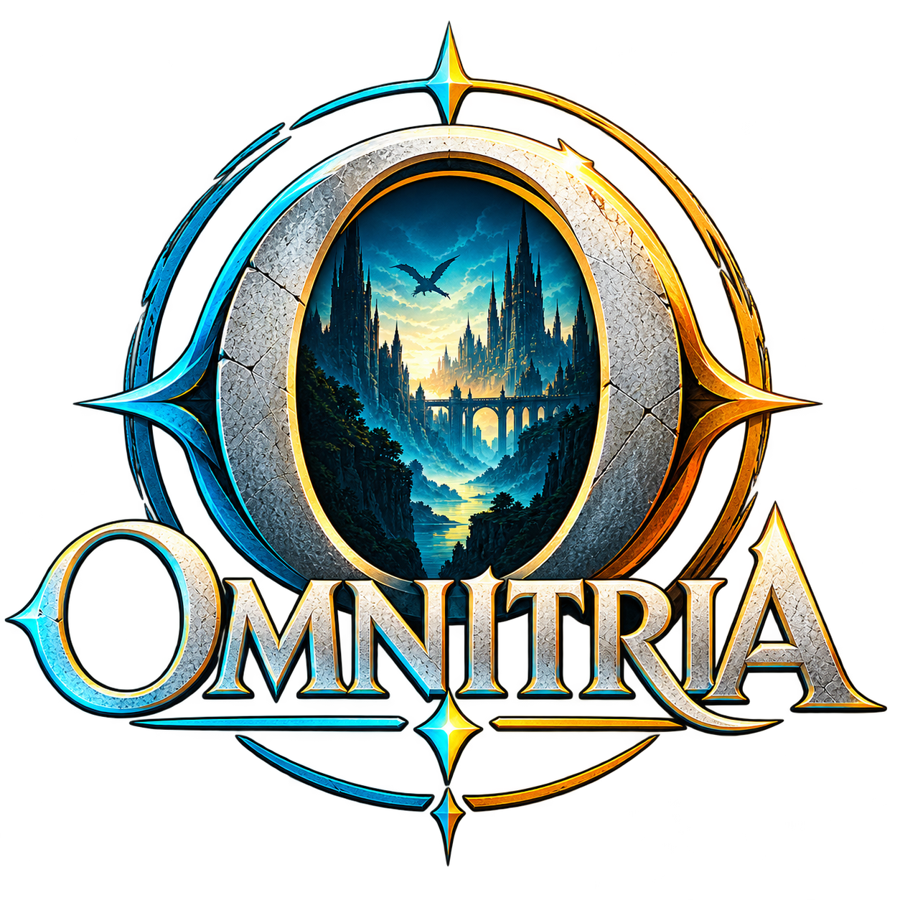
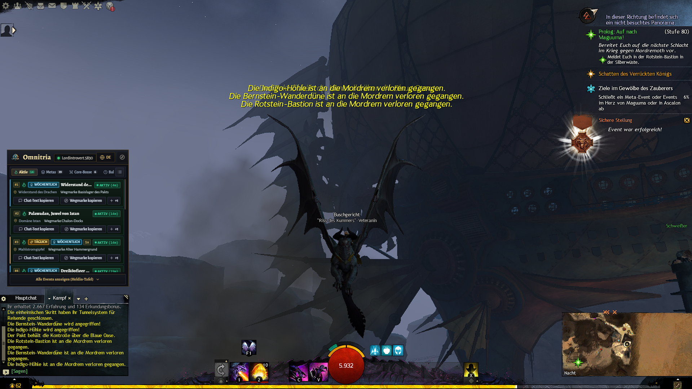
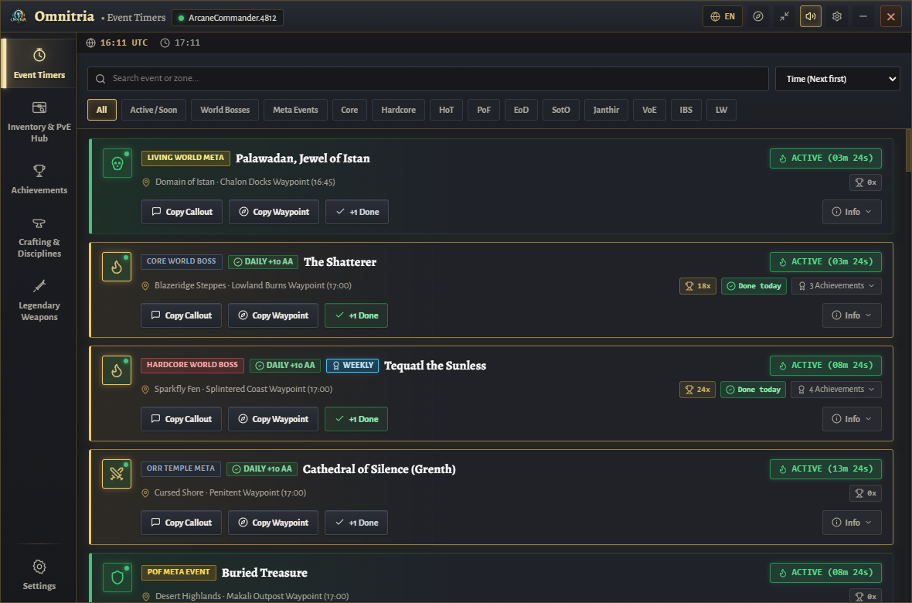
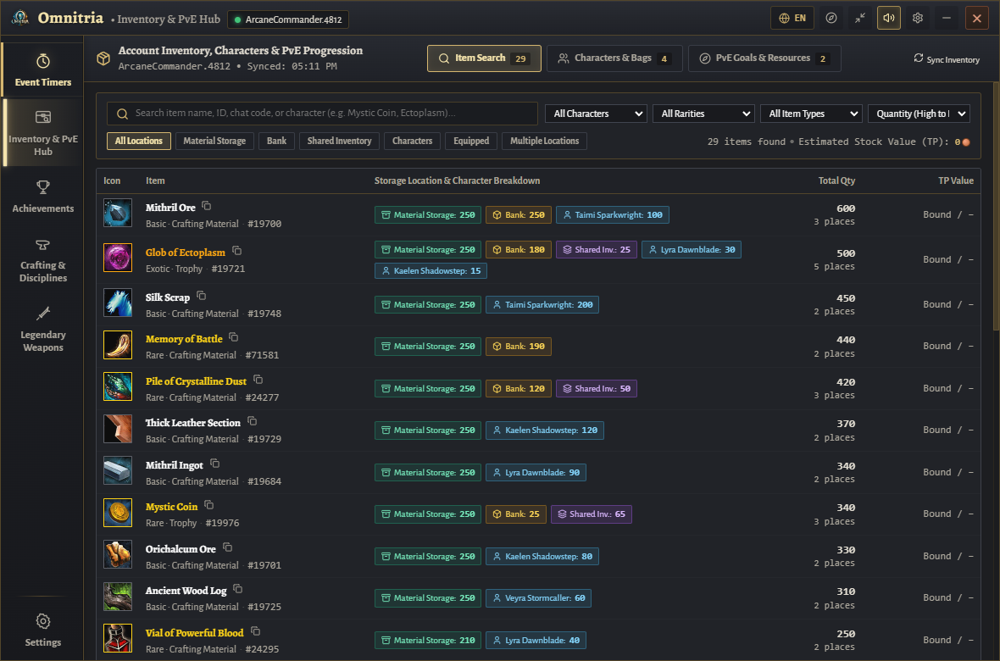
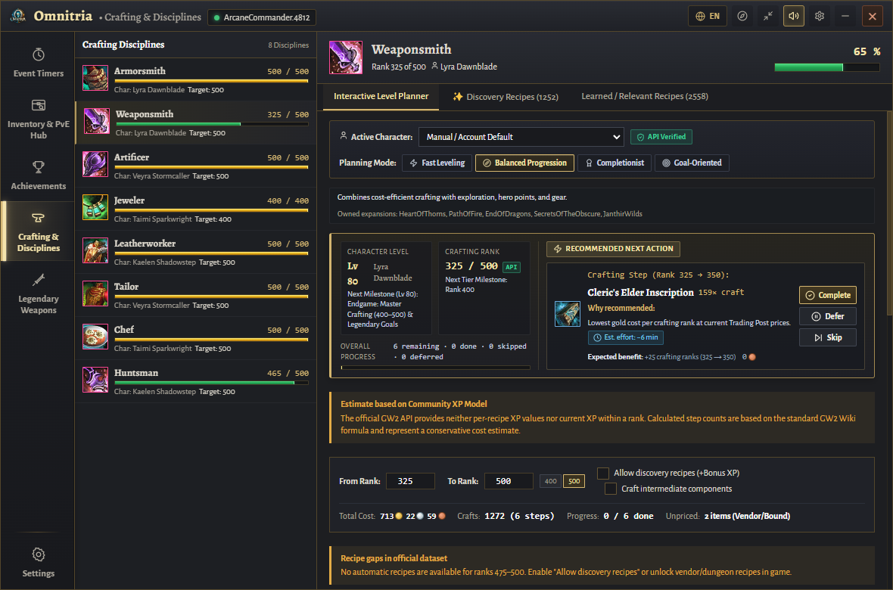

<div align="center">



# Omnitria HUD

[](https://github.com/Booster1212/guildwars2-omnitria/releases)
[](https://github.com/Booster1212/guildwars2-omnitria/releases)
[](#installation)
[](LICENSE)

Omnitria is an open-source desktop companion and HUD overlay for Guild Wars 2. It calculates local event timers, indexes account-wide inventories, optimizes crafting paths, and recommends achievements using official read-only APIs.

<br/>



</div>

## Features

- **Event Timers & World Bosses:** Live countdowns for 57 world bosses and expansion meta-events based on Tyria's deterministic 2-hour UTC rotation cycle, with one-click Clipboard copying for fast-travel waypoints (`[&...]`).
- **Account-Wide Item Search:** Indexed lookup across Material Storage, Bank tabs, Shared Inventory slots, Character Bags, and Equipped Gear without double-counting items stored across multiple locations.
- **Achievement Recommendations & Total AP:** Deterministic ranking of achievements by obtainable points, completion progress, and remaining objectives across five strategies (*Best Next*, *Best Efficiency*, *Quick Wins*, *Highest Reward*, *Continue Progress*). Enforces point caps on repeatable achievements (e.g. *Agent of Entropy* at 250 AP) and calculates total account AP according to official cap rules (`min(15000, daily + monthly) + permanent`). Public metadata is browsable in Guest Mode without an API key.
- **0–500 Crafting Level Planner:** Computes lowest-cost leveling paths across all 8 crafting disciplines using community XP formulas, with automatic deductions for materials already in your account inventory.
- **Legendary Armory Trees:** Interactive component graphs and bills of materials for Gen 1, Gen 2, and Gen 3 Legendary weapons with live Black Lion Trading Post pricing and Craft-vs.-Buy toggles.
- **Overlay Modes & Hotkeys:** Full Hero Board or compact Mini-HUD docked above the in-game chat box, with global hotkeys (`F9` to toggle overlay visibility, `F10` for click-through mode) and bilingual UI (English and German).

## Screenshots

| Event Rotation Board | Achievement Recommendations |
| :---: | :---: |
|  |  |
| **Account Item Search** | **Crafting & Leveling Planner** |
|  |  |

## Installation

### Standalone Binary (Windows)

1. Download `Omnitria-v0.2.5-windows-x64.zip` from [GitHub Releases](https://github.com/Booster1212/guildwars2-omnitria/releases).
2. Extract the archive to any folder (portable, no installer required).
3. Launch `Omnitria.exe`.

> **Display Requirement:** Guild Wars 2 must run in **Windowed Fullscreen** or **Windowed** mode for the overlay to render above the game window.

### Connecting an API Key

Public event timers, crafting recipes, and achievement definitions are available immediately in Guest Mode. Connecting an official ArenaNet API key (read-only scopes: `account`, `inventories`, `characters`, `progression`, `unlocks`) enables account inventory search and personal achievement progress. Keys are stored locally and encrypted using Windows DPAPI (`safeStorage`).

## Development

Prerequisites: **Node.js 20+** and **npm**.

```bash
# Install dependencies
npm ci

# Start Vite dev server and Electron overlay concurrently
npm run overlay

# Run tests
npm test

# Check TypeScript types
npm run typecheck

# Build renderer production bundle
npm run build

# Package standalone Windows executable
npm run package:win
```

## Documentation

- [ArenaNet Policy & Compliance Review](docs/TOS_COMPLIANCE.md) — Technical audit covering read-only API access, zero memory modification, and clipboard-only integration.
- [Architecture & Data Sources](docs/DATA_SOURCES.md) — Event rotation algorithms, inventory indexing, crafting XP decay model, and caching tiers.
- [Changelog](docs/CHANGELOG.md) — Version history and release notes.

## Legal & Compliance

Guild Wars 2, ArenaNet, and all associated logos are trademarks or registered trademarks of NCsoft Corporation.

Omnitria is designed to minimize risk under ArenaNet's published third-party-program guidelines. It has not been reviewed, approved, or endorsed by ArenaNet. Use at your own risk.
