<div align="center">


# ✨ Omnitria • Guild Wars 2 In-Game Overlay

[](https://github.com/Booster1212/guildwars2-omnitria/releases)
[](https://github.com/Booster1212/guildwars2-omnitria/releases)
[](https://github.com/Booster1212/guildwars2-omnitria/actions)
[](#-system-requirements)
[](LICENSE)
[](#-bilingual-support)

<br/>

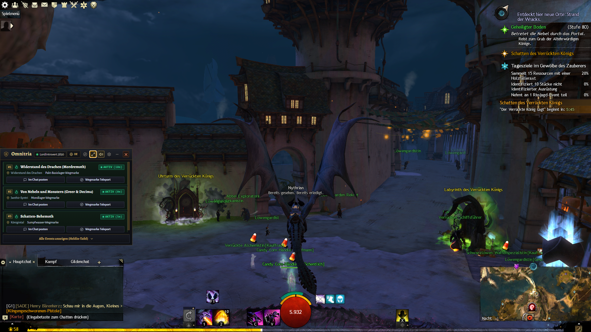

<br/>

**Omnitria** is a high-performance, immersive in-game companion and overlay for **Guild Wars 2**.  
Seamlessly hovering above your in-game chat box as a compact mini-HUD or expanding into a full-screen Hero Board.  
Crafted with authentic Guild Wars 2 visual aesthetics: dark slate backdrop, antique bronze & gold borders, GW2 rarity color palettes, and official ArenaNet artwork.

[📥 Download Latest Release](https://github.com/Booster1212/guildwars2-omnitria/releases/latest) • [📖 Architecture & Data Sources](docs/DATA_SOURCES.md) • [🎮 Quick Start](#-quick-start--installation) • [💬 Controls](#-controls--shortcuts)

</div>

---

## 🌟 Key Highlights

* 🕒 **Second-Accurate Rotation Schedule:** Continuous live countdowns across all expansions (*Core, HoT, PoF, EoD, SotO, Janthir Wilds, Visions of Eternity*), including Orr Temple Meta-Events (Cathedral of Zephyrs / Dwayna and Cathedral of Eternal Radiance / Lyssa).
* ⚔️ **WvW Tactical Assistant:** Real-time strategic objective scoring, Righteous Indignation (RI) countdown timers, interactive vector radar map, live EU/NA match standings, and automated team detection.
* 💬 **1-Click Game Chat Callouts:** Broadcast waypoint chat codes and remaining boss countdowns directly into map chat (`/m`).
* 🔨 **Intelligent 0–500 Crafting Level Planner:** Optimal, algorithmically generated lowest-cost routes with embedded discovery recipes and automatic material storage deductions.
* 🗡️ **Interactive Legendary Armory:** Hierarchical Mystic Forge recipe trees, live Black Lion Trading Post material pricing, and step-by-step precursor achievement tracking.
* 🏆 **Hero Panel & Achievements:** Pin achievements to a custom watchlist, track sub-objectives with interactive checkboxes, and view tier rewards with Mastery Point badges.
* ⚡ **Seamless In-Game Workflow:** Quick minimize with `[Esc]`, instant `[F9]` toggle, click-through mode with `[F10]`, and over-chat dock anchoring.
* 🔄 **Built-in Auto-Updater:** Seamless in-app version checks against GitHub Releases with 1-click background downloading and automated restart.
* 🛡️ **100% Safe & Read-Only:** Official ArenaNet API key integration stored locally on your machine. Zero tracking, zero telemetry, zero modifications to game files.
* 🌐 **Bilingual Support:** Instant 1-click toggle between **English** and **Deutsch** throughout the entire application.

---

## 🧭 Core Modules & Feature Showcase

### 🏰 1. Event Timers & World Bosses (`Events`)

Stay on top of every meta-event, world boss, and timed group activity in Tyria without alt-tabbing or browsing external wiki pages.

| Full Hero Board View | Active & Upcoming Filter | Compact Mini-HUD (Over-Chat) |
| :---: | :---: | :---: |
| [](docs/screenshots/hero-board.png) | [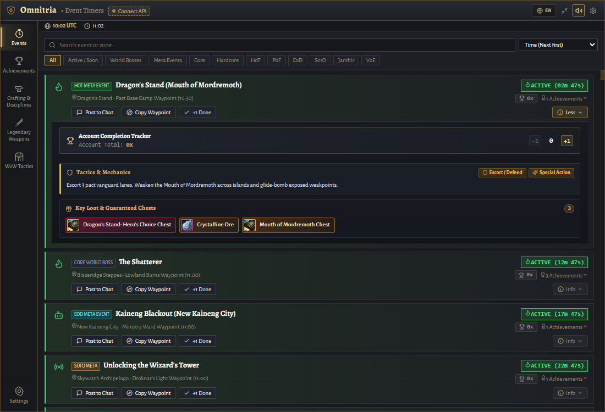](docs/screenshots/events-active.png) | [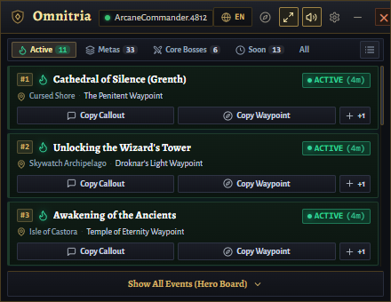](docs/screenshots/mini-hud.png) |
| *Full Hero Board with real-time rotation schedule, boss tactics, and loot highlights.* | *Filtered by currently active or upcoming meta-events.* | *Minimalist HUD hovering directly over the in-game GW2 chat box.* |

* **Deterministic Second-by-Second Accuracy:** Calculations are computed locally against Tyria's fixed 2-hour rotation schedule — guaranteed zero lag, zero server desync.
* **Temple Meta-Events:** Integrated coverage for Malchor's Leap temple metas: Cathedral of Zephyrs (Dwayna) and Cathedral of Eternal Radiance (Lyssa).
* **1-Click Map Chat Broadcasts:** Click the send icon to automatically paste waypoints and countdown timers into your game chat.
* **Waypoint Fast Travel:** Click any waypoint code to immediately copy it to your clipboard for instant in-game map navigation.
* **Boss Cheat Sheets:** Expand any card for boss mechanics, defiance bar (CC) triggers, phase timings, and rare drop highlights.

---

### 🏆 2. Hero Panel & Achievements Tracker (`Achievements`)

Transform the overwhelming Guild Wars 2 achievement catalog into an actionable, real-time checklist integrated directly with your ArenaNet account.

| Hero Panel & Watchlist | World Boss & Meta Achievements |
| :---: | :---: |
| [](docs/screenshots/achievements-hero-panel.png) | [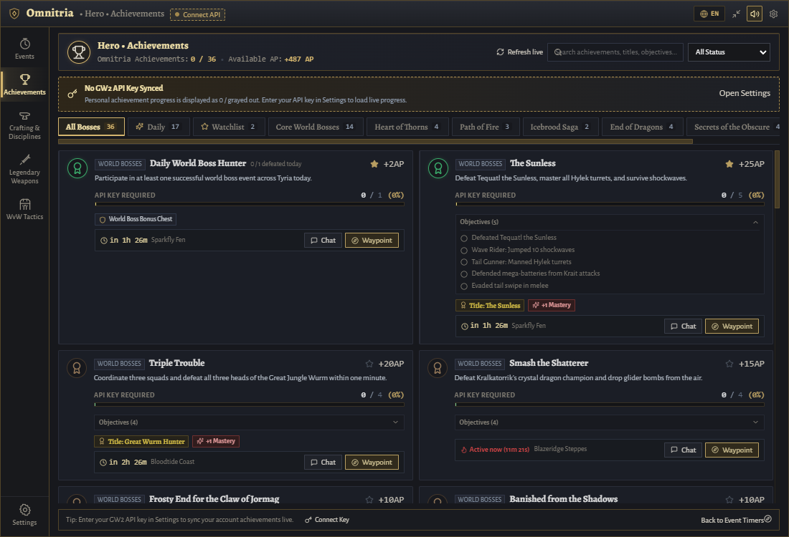](docs/screenshots/achievements-detail.png) |
| *Hero Panel layout with custom pinned Watchlist and tier progress.* | *Live event status integration, sub-objective checkboxes & reward badges.* |

* **Custom Watchlist:** Pin your high-priority goals (e.g. *Daily Completionist, Fractal God, Envoy Armor*) to a persistent top watchlist.
* **Live Event Linkage:** Boss achievements link directly to the event schedule, showing remaining spawn times and fast-travel buttons.
* **Visual Reward Indicators:** Distinct badges for Mastery Points (*Tyria, Maguuma, Desert, Cantha*), AP points, and custom character titles.
* **Deep Category Filtering:** Quick navigation through *Dailies, World Bosses, Fractals, Raids, Exploration, and Precursor Collections*.

---

### 🔨 3. Crafting Level Planner & Discovery Assistant (`Crafting`)

Level any of the 8 crafting disciplines (*Armorsmith, Weaponsmith, Artificer, Jeweler, Leatherworker, Tailor, Chef, Huntsman*) from 0 to 400 or 500 with minimum gold expenditure.

| 0–500 Level Planner & BOM | Undiscovered Recipe Explorer |
| :---: | :---: |
| [](docs/screenshots/crafting-planner.png) | [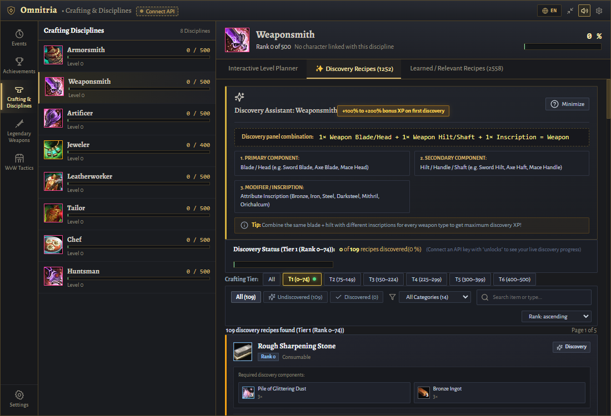](docs/screenshots/crafting-discovery.png) |
| *Step-by-step route with Bill of Materials and material storage deduction.* | *Filter and search undiscovered recipes by discipline, tier, and item name.* |

* **Wiki-Calibrated XP Progression:** Evaluates optimal recipes based on XP decay formulas, preferring self-crafted intermediate items (e.g. Silk Insignias) over costly purchases.
* **Automatic Inventory Deduction:** When connected with your API key, items stored in your Material Storage, Bank, and Character Bags are subtracted from the Bill of Materials (BOM).
* **Embedded Discovery Helper:** When leveling requires discovery combinations, ingredient sets and discovery instructions are displayed directly on the step card.
* **Discovery Explorer:** Dedicated catalog of all undiscovered recipes with search filters by discipline, tier, and ingredient.
* **Learned & Relevant Recipe Book:** Complete discipline recipe database with tier navigation, live account unlock status, instant craftability checks against material storage, and Trading Post valuation.

---

### 🗡️ 4. Legendary Armory & Mystic Forge Trees (`Legendary`)

Comprehensive blueprint database for crafting legendary weapons across all generations (*Gen 1, Gen 2, Gen 3 / Aurene, and Gen 4 / Janthir Wilds*).

| Legendary Weapons Catalog | Hierarchical Mystic Forge Tree | Bill of Materials (BOM) & TP Prices |
| :---: | :---: | :---: |
| [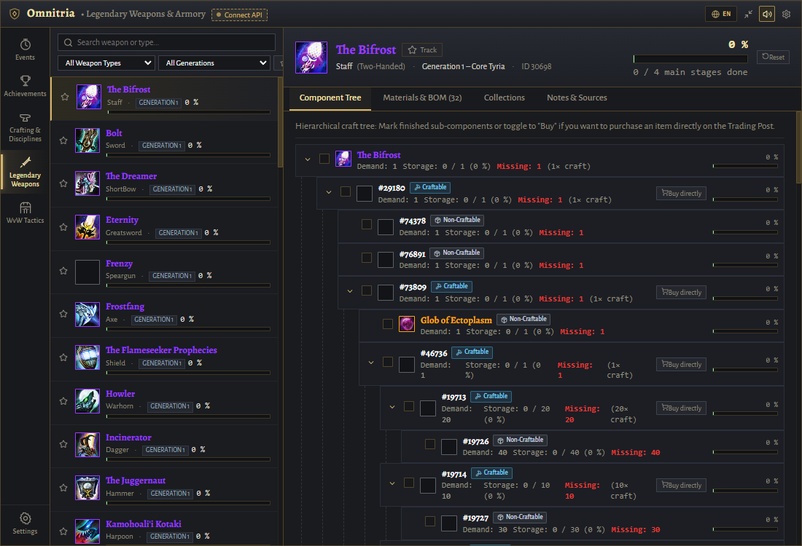](docs/screenshots/legendary-armory.png) | [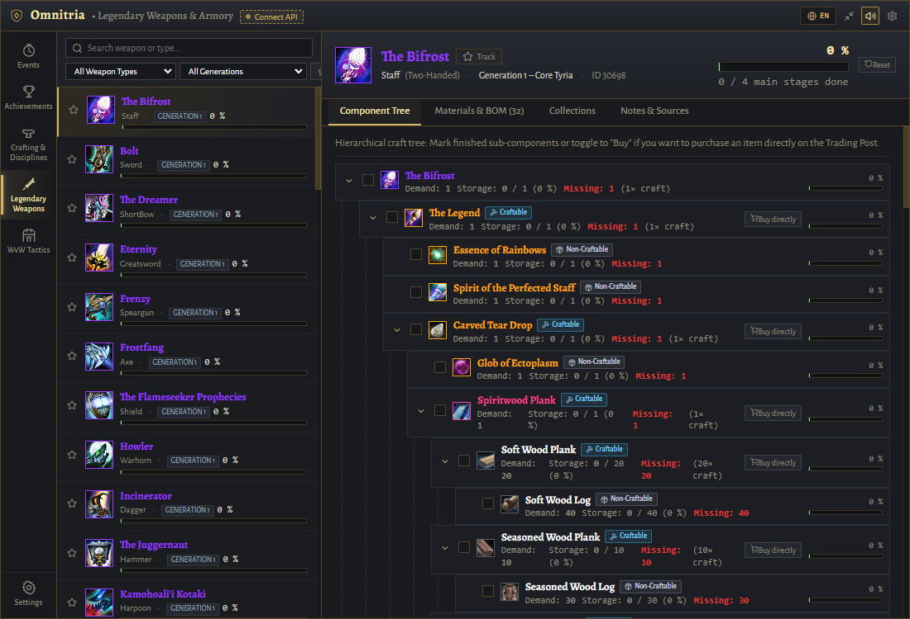](docs/screenshots/legendary-tree.png) | [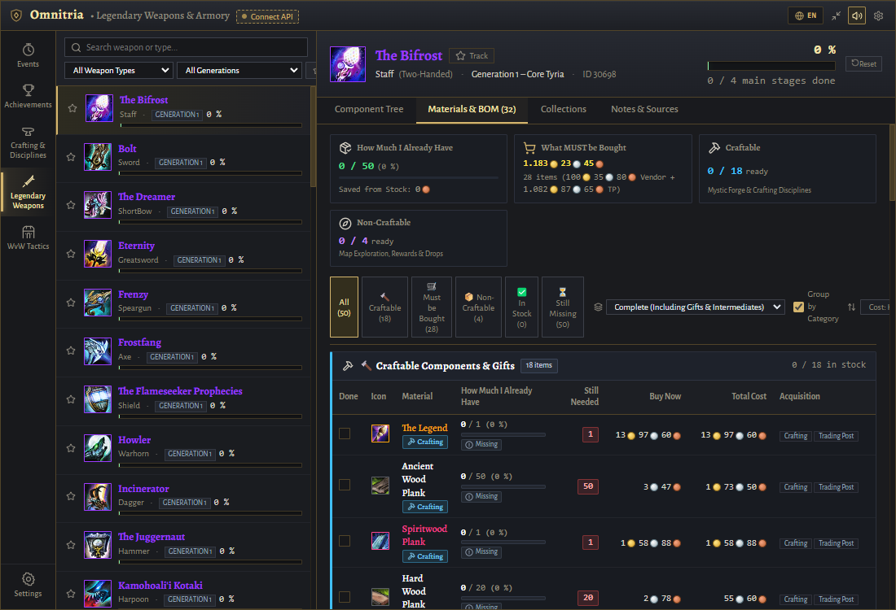](docs/screenshots/legendary-materials.png) |
| *Browse all legendary weapons filtered by generation, weapon type, and expansion.* | *Recursive node tree with 4 Mystic Forge branches and ingredient icons.* | *Comprehensive BOM shopping list with live TP buy/sell prices & inventory deduction.* |

* **Hierarchical Node Tree:** Visual breakdown of the 4 primary Mystic Forge components down to basic raw materials.
* **Live Black Lion Trading Post Prices:** Real-time buy-order and instant-sell prices fetched from `/v2/commerce/prices` with total gold, silver, and copper calculations.
* **Smart "Craft vs. Buy" Toggle:** Choose whether you plan to craft or directly purchase tradeable components (e.g. *Eldritch Scroll, Mystic Runestones, Amalgamated Gemstones*); the BOM updates dynamically.
* **Precursor Collection Steps:** Track achievement steps and requirements for legendary precursor crafting.

---

### ⚔️ 5. WvW Tactical Assistant & Live Map (`WvW Tactics`)

Real-time World vs. World companion providing algorithmic objective scoring, interactive radar mapping, and live match dashboard tracking across European and North American matchups.

| Tactical Objective Advisor | Interactive Tactical Map | Match Dashboard & Standings |
| :---: | :---: | :---: |
| [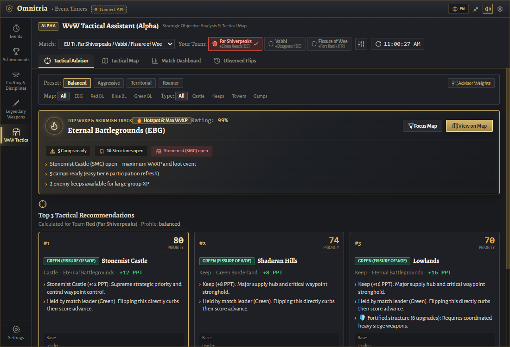](docs/screenshots/wvw-advisor.png) | [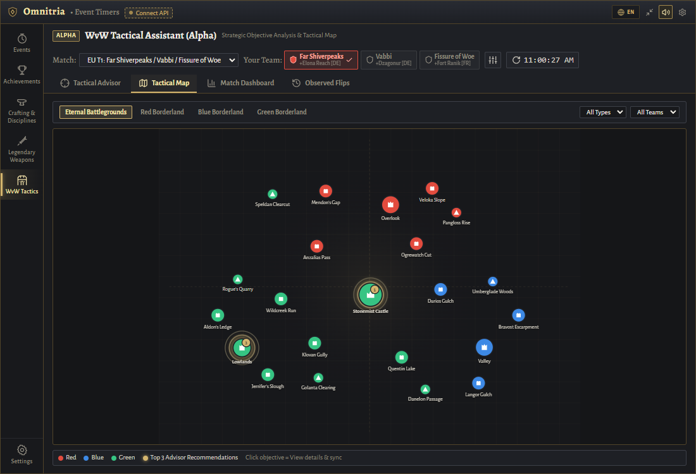](docs/screenshots/wvw-map.png) | [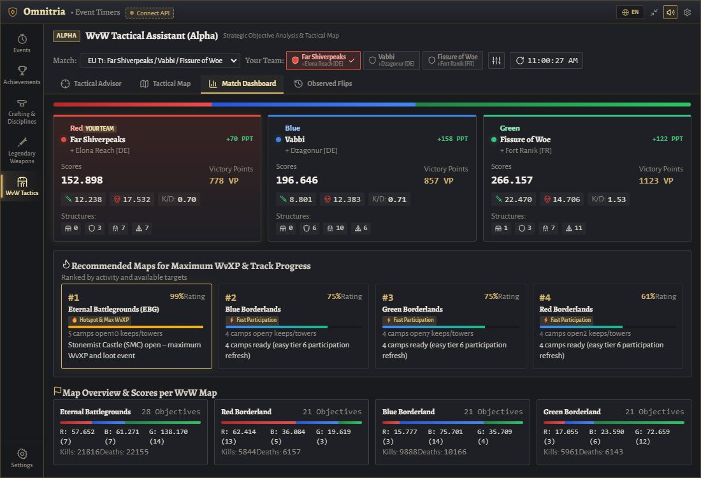](docs/screenshots/wvw-dashboard.png) |
| *Smart priority scoring with Righteous Indignation (RI) timers and tactical rationale.* | *Interactive SVG radar map showing objective nodes, team control borders, and guild claims.* | *Live match standings, server lineups, VP progression, and WvXP activity rankings.* |

* **Smart Multi-Factor Scoring Engine:** Evaluates Righteous Indignation (RI) vulnerability, Points Per Tick (PPT) strategic value, structure upgrade tiers, distance from home spawn, and match leadership momentum.
* **Dynamic Tactical Presets:** One-click strategy presets (`Balanced`, `Aggressive`, `Territorial`, `Roamer`) or customizable priority weight sliders.
* **Interactive Vector Radar Map:** Covers Eternal Battlegrounds (EBG) and Alpine / Desert Borderlands with real-time objective nodes (Camps, Towers, Keeps, Stonemist Castle, Mercenaries, Ruins).
* **Live Server & Match Resolution:** Queries `/v2/wvw/matches` and `/v2/worlds` to resolve authentic team names (e.g. *Far Shiverpeaks / Vabbi / Fissure of Woe*) and automatically derives your team color from your account home world.
* **Session Capture Logger:** Tracks objective flips live with timestamps, team transitions, and RI countdown timers.

---

### ⚙️ 6. In-App Settings, Account Sync & Auto-Updater (`Settings`)

Configure appearance, customize chat callouts, sync your account credentials, and receive automatic version updates with zero friction.

| Account Sync & Settings Modal | In-App Auto-Updater & Version Management |
| :---: | :---: |
| [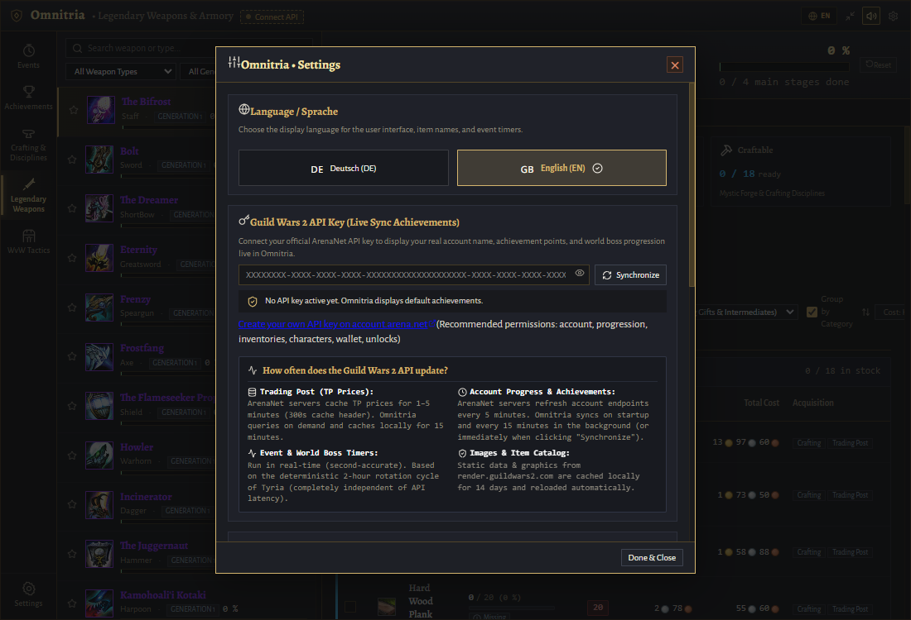](docs/screenshots/settings-modal.png) | [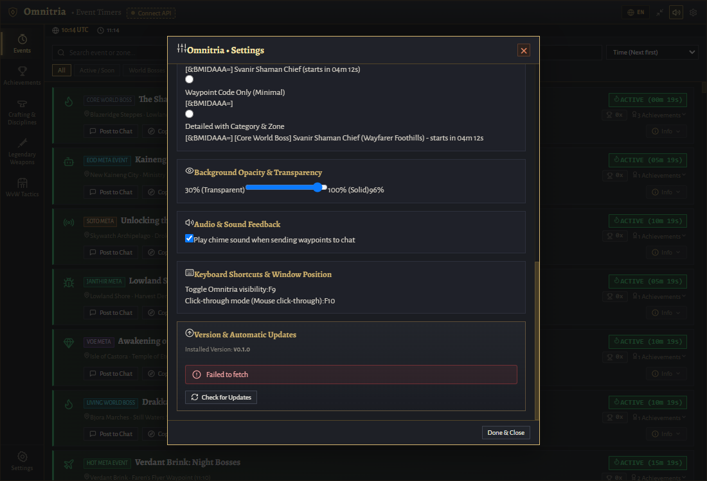](docs/screenshots/settings-updater.png) |
| *Language selection, API key validation, opacity slider, and hotkeys.* | *Live GitHub release checking with 1-click background downloading.* |

* **Version & Update Management:** Shows your currently installed version and queries the latest GitHub release.
* **1-Click Background Updates:** Downloads the new Windows distribution archive in the background with progress feedback and automatically re-launches Omnitria.
* **Custom Chat Formatting:** Select between *Standard, Compact, Minimal (Waypoint Only)*, or *Detailed* chat templates.
* **Window Transparency:** Adjust background opacity from 30% (semi-transparent glass) to 100% (solid dark slate).

---

## 🔑 Guild Wars 2 API Key Integration (Official & Safe)

Omnitria communicates exclusively with official **ArenaNet API servers** (`https://api.guildwars2.com/v2/`).

> [!IMPORTANT]
> ### 🛡️ 100% Safe & Read-Only
> - **Cannot Modify Your Account:** ArenaNet API keys are **strictly read-only**. No third-party application can spend your gold, delete items, move characters, or access account credentials.
> - **Stored Locally Only:** Your API key is stored exclusively in your local machine's encrypted application storage.
> - **Zero Third-Party Servers:** Omnitria operates without intermediate backend servers or telemetry tracking.
> - **Optional:** Omnitria is 100% functional without an API key for event timers, waypoints, database exploration, and leveling guides.

### Recommended ArenaNet Scopes & Permissions Matrix

| ArenaNet Checkbox | Priority | What it Unlocks in Omnitria | If Unchecked |
| :--- | :---: | :--- | :--- |
| ☑️ **`account`** | 🔴 **MANDATORY** | Base verification, commander tag status, account age, fractal level, WvW rank. | Key cannot be connected (Guest Mode). |
| ☑️ **`progression`** | 🟢 **ESSENTIAL** | Live achievement checklists, daily completionist tracker, and mastery points. | Achievements display default progression (0%). |
| ☑️ **`inventories`** | 🟢 **ESSENTIAL** | Material Storage, Bank tabs & Shared Inventory deduction in crafting BOMs. | BOMs display full quantities without subtracting owned items. |
| ☑️ **`characters`** | 🟢 **ESSENTIAL** | Detection of active character crafting discipline levels (e.g. Weaponsmith 500). | Crafting discipline ranks must be selected manually. |
| ☑️ **`unlocks`** | 🟢 **ESSENTIAL** | Identifies learned recipes and highlights undiscovered recipes in the Discovery Explorer. | All recipes appear unlearned. |
| ☑️ **`wallet`** | 🟡 **RECOMMENDED** | Live account currency balances (laurels, fractal relics, astral acclaim). | Currency balances are hidden. |

### How to Connect Your API Key

1. Log in to your official ArenaNet account at: **[account.arena.net/applications](https://account.arena.net/applications)**.
2. Click **"New Key"** (or *"Neuer Schlüssel"* in German).
3. Name your key (e.g. `Omnitria Overlay`) and select the recommended scopes above (or click **"Select All"**).
4. Copy the generated 72-character key.
5. In Omnitria, open **Settings (⚙️)**, paste the key into the input field, and click **Save & Sync**.

---

## 🎮 Controls & Shortcuts

| Action | Shortcut / Control | Description |
| :--- | :---: | :--- |
| **Minimize Window** | `[Esc]` | Minimizes or hides the overlay window, immediately returning focus to Guild Wars 2. |
| **Toggle Overlay** | `[F9]` | Instantly show or hide the overlay window over Guild Wars 2. |
| **Click-Through Mode** | `[F10]` | Makes the overlay click-transparent so mouse clicks pass directly into the game. |
| **Chat Dock Anchor** | `🧭 Compass Icon` | Automatically docks the window directly above your in-game chat box (bottom-left). |
| **Language Switcher** | `🇬🇧 EN` / `🇩🇪 DE` | Instant 1-click toggle between English and German. |
| **System Tray Menu** | *Right-Click Tray Dragon* | Window modes, docking, toggle click-through, and exit. |

---

## ⚡ Quick Start & Installation

### System Requirements
* **Operating System:** Windows 10 or Windows 11 (64-bit)
* **Guild Wars 2 Display Mode:** **Windowed Fullscreen** or **Windowed** *(recommended for all overlay applications)*
* **Node.js:** *(Optional, only needed if running from source)* v18 or newer

### Installation Options

#### Option A: Standalone Release (Recommended for Players)
1. Download the latest release archive (`Omnitria-vX.X.X-windows-x64.zip`) from **[Releases](https://github.com/Booster1212/guildwars2-omnitria/releases/latest)**.
2. Extract the archive into any folder of your choice (e.g. `C:\Games\Omnitria`).
3. Launch Omnitria:
   * **Silent Background Mode (Recommended):** Double-click `Omnitria-Silent.vbs` (runs quietly in tray without a terminal window).
   * **Direct Executable:** Double-click `Omnitria.exe` or `Omnitria.bat`.

#### Option B: Running from Source (For Developers)
```bash
# 1. Clone repository
git clone https://github.com/Booster1212/guildwars2-omnitria.git
cd guildwars2-omnitria

# 2. Install dependencies via lockfile
npm ci

# 3. Launch live overlay in development mode
npm run overlay
```

---

## 🛠️ Development & Testing

```bash
# Run TypeScript typechecks
npm run typecheck

# Run automated domain & calculation test suite (63 tests)
npm test

# Build production client bundle
npm run build

# Package standalone Windows release locally
npm run package:win
```

For complete technical documentation on the data acquisition architecture, API endpoints, caching strategies, and mathematical estimation models, refer to [docs/DATA_SOURCES.md](docs/DATA_SOURCES.md).

---

## 📜 Legal & ArenaNet Notice

Guild Wars 2, ArenaNet, and all associated logos and designs are trademarks or registered trademarks of NCsoft Corporation.  
Omnitria is an independent, fan-made open-source overlay companion and is not affiliated with or endorsed by ArenaNet or NCsoft. All in-game art, icons, weapon renderings, and lore assets are property of ArenaNet and NCsoft.
