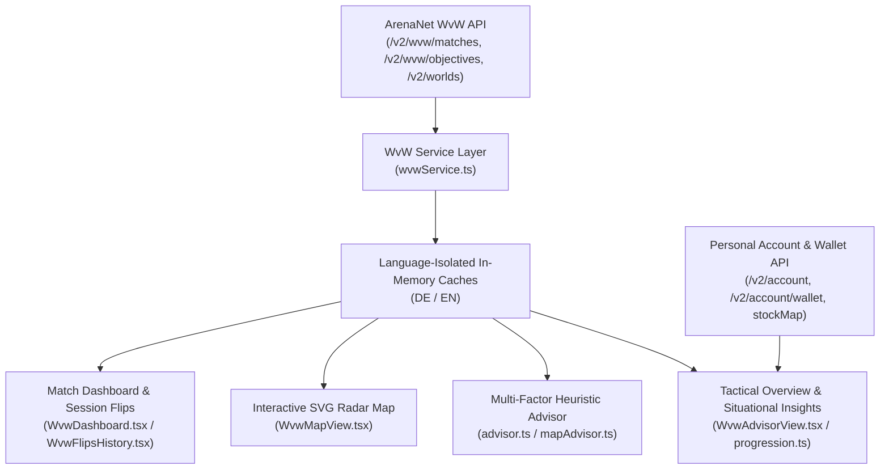

# Data Sources, Architecture & Data Limitations

This document describes the complete data acquisition architecture, data source classifications, inventory deduplication rules, algorithmic estimation models, caching strategies, and operational constraints of the **Omnitria** Guild Wars 2 In-Game Overlay.

---

## 1. Data Classification & Source Tiers

All data within Omnitria is strictly partitioned into distinct source classes and labeled transparently across the user interface:

| Class | UI Badge | Source | Description & Usage |
|---|---|---|---|
| **Official Content** | `API` | Official ArenaNet API (`api.guildwars2.com/v2`) | Item definitions, localized names (`en` / `de`), tooltips, official crafting recipes, achievement categories, and icon render URLs. |
| **Account & Inventory** | `Account` | Authenticated endpoints (`/v2/account/*`, `/v2/characters`) | Material Storage, Bank tabs, Shared Inventory slots, Character bag inventories, Equipped character gear, crafting discipline ratings, wallet currencies, and live achievement states. |
| **Market Data** | `API` | `/v2/commerce/prices` | Real-time buy orders (instant sell) and sell listings (instant buy) from the Black Lion Trading Post. |
| **World vs. World** | `WvW / API` | `/v2/wvw/*` & `/v2/worlds` | Public live match scores, Victory Points (VP), Points Per Tick (PPT), Kill/Death totals, objective ownership, Righteous Indignation (RI) windows, server names, and team assignments. |
| **Community Data** | `Community` | Vendored dataset [`crafty_legend`](https://github.com/PieOrCake/crafty_legend) (MIT License) | **Mystic Forge** recipe graphs and item acquisition channels (world exploration, karma vendors, dungeon tokens). |
| **Calculated Engine** | `Calculated` | Domain engine (`src/domain/`, `src/data/gw2/wvw/`) | Consolidated account inventory search index, deduplicated multi-goal material demand, net Bills of Materials (BOM), 0–500 leveling step routes, rule-based WvW situational insights, and rotation countdowns. |

---

## 2. ArenaNet API Endpoints & Permissions Matrix

Omnitria communicates directly with official ArenaNet API servers (`https://api.guildwars2.com/v2`) without intermediary relay proxies or third-party collection servers.

### 2.1 Authenticated Account Endpoints (Read-Only)

| Feature | API Endpoint | Required Scope | Fallback Behavior if Scope Unchecked / Guest Mode |
|---|---|---|---|
| **Base Account Sync** | `/v2/account` | `account` | Guest Mode: Overlay functions without personal account linkage (`world` and `wvw_rank` unavailable). |
| **Achievements Progress** | `/v2/account/achievements` | `progression` | Displays static achievement catalog with 0% progress. |
| **Daily Boss Completions** | `/v2/account/worldbosses` | `progression` | Boss completion checkmarks can still be marked manually. |
| **Map Chest Completions** | `/v2/account/mapchests` | `progression` | Map chest completion states remain unmarked unless toggled manually. |
| **Wizard's Vault Daily** | `/v2/account/wizardsvault/daily` | `progression` | Daily Wizard's Vault objective progress is omitted from WvW and PvE summaries. |
| **Material Storage** | `/v2/account/materials` | `inventories` | Material Storage quantities are omitted from Account-Wide Item Search and BOM deductions. |
| **Bank Tabs** | `/v2/account/bank` | `inventories` | Bank tab items are omitted from Account-Wide Item Search and BOM deductions. |
| **Shared Inventory** | `/v2/account/inventory` | `inventories` | Shared inventory slots are omitted from Account-Wide Item Search and BOM deductions. |
| **Characters Overview** | `/v2/characters?ids=all` | `characters` | Character cards (level, profession, playtime, active crafting disciplines) are unavailable; discipline ratings can be set manually. |
| **Character Bag Inventories** | `/v2/characters?ids=all` + fallback `/v2/characters/:id/inventory` | `characters` + `inventories` | Per-character bag stacks are omitted; permission banner explains which scope (`characters` or `inventories`) is missing. |
| **Character Equipment** | `/v2/characters?ids=all` (`equipment` array) | `characters` (+ `builds` / `inventories`) | Equipped items on characters are omitted from the `Equipped` filter and character cards. |
| **Currencies & Wallet** | `/v2/account/wallet` | `wallet` | Wallet balances (Gold, Karma, Spirit Shards, Laurels, Badges of Honor, WvW Skirmish Claim Tickets) are hidden. |
| **Learned Recipes** | `/v2/account/recipes` | `unlocks` | Recipe Book displays recipes as unlearned; only `AutoLearned` recipes are marked known. |
| **Legendary Armory** | `/v2/account/legendaryarmory` | `unlocks` | Owned Legendary Armory items are not automatically marked as unlocked. |
| **WvW Home World & Rank** | `/v2/account` (`world`, `wvw_rank`) | `account` | Player selects active WvW team manually; personal WvW rank progression panel prompts for API key connection. |

### 2.2 Public Endpoints (No API Key Required)

| Module | API Endpoint | Cache Strategy | Purpose |
|---|---|---|---|
| **WvW Matches** | `/v2/wvw/matches` | 30s Polling / Adaptive Backoff | Live match scores, victory points, kills, deaths, maps, and objective states. |
| **WvW Objectives** | `/v2/wvw/objectives?ids=all` | Persistent (14-day TTL) | Static coordinates, objective types (Camps, Towers, Keeps, Castle, Ruins, Mercenaries), and sectors. |
| **World Names** | `/v2/worlds?ids=all` | Persistent (14-day TTL) | Resolves numerical world IDs into localized server names in English (`en`) and German (`de`). |
| **Guild Details** | `/v2/guild/{id}` | In-Memory (Session) | Resolves claiming guild names and tags (`[TAG]`) for WvW objectives. |
| **Trading Post Prices** | `/v2/commerce/prices` | 5-Minute In-Memory | Live buy/sell prices for Account Inventory valuation, Legendary BOMs, and Crafting routes. |
| **Item Metadata** | `/v2/items` | IndexedDB (14-day TTL) | Item icons, localized names (`en` / `de`), rarities, item types, vendor values, and chat links. |
| **Crafting Recipes** | `/v2/recipes` | IndexedDB (14-day TTL) | Official discipline recipe inputs, outputs, ratings, and flags. |
| **Game Build** | `/v2/build` | On Startup | Detects new Guild Wars 2 game builds to invalidate stale item/recipe caches. |

---

## 3. Account-Wide Item Search, Character Inventories & Multi-Goal Planning

### 3.1 Consolidated Inventory Ingestion (`src/data/gw2/account.ts`)
When synchronizing with a valid ArenaNet API key, Omnitria queries `/v2/account/materials`, `/v2/account/bank`, `/v2/account/inventory`, and `/v2/characters?ids=all` in parallel:
- **Empty Slots & Null Safety:** Empty bank tabs, empty shared inventory slots, and unequipped bag slots (`null` entries in ArenaNet arrays) are ignored safely.
- **Character Bag Fallback:** If `/v2/characters?ids=all` omits the `bags` property for a character while the API key includes the `inventories` permission, Omnitria automatically queries `/v2/characters/:id/inventory` (URL-encoded character name) so per-character bag contents are still captured.
- **Zero Double-Counting Guarantees (`src/domain/inventorySearch.ts`):**
  - `totalStock` = `Material Storage` + `Bank` + `Shared Inventory` + `Character Bags`.
  - Each item stack is attributed to its exact storage location (`materials`, `bank`, `shared`, or `character_bag` with `characterName`).
  - `equippedCount` tracks items currently equipped in a character's `equipment` slots (`character_equipped`) separately from `totalStock`, so equipped weapons/armor are searchable without falsely inflating consumable crafting stock.
  - `totalCount` = `totalStock` + `equippedCount`.

### 3.2 Search, Filtering & Location Awareness
- **Bilingual Localized Search:** `filterAndSortAccountInventory` matches full or partial item names (case-insensitive) in the active UI language (`en` or `de`), numeric item IDs, chat codes, or the holding character's name.
- **Storage Location Filters:** Users can filter by `All Locations`, `Material Storage`, `Bank`, `Shared Inventory`, `Characters`, `Equipped`, or `Multiple Locations` (items fragmented across 2+ storage places), as well as by individual character name, item rarity, and item type.
- **BOM & Material Detail Integration:** Both Legendary and Crafting Bills of Materials (`MaterialTable.tsx`, `MaterialDemandTable.tsx`, `MaterialDetail.tsx`) display per-location and per-character stock badges (e.g., `Mat: 250 · Bank: 180 · Shared: 25 · Lyra Dawnblade: 30`) so players know exactly where to withdraw materials.

### 3.3 Multi-Goal Material Deduplication (`computeMultiGoalMaterialPlan`)
When a player tracks multiple Legendary weapons simultaneously, `computeMultiGoalMaterialPlan` aggregates leaf material requirements across all active goals against the account's single `stockMap`:
- If **Goal A** requires `250` Mystic Coins and **Goal B** requires `250` Mystic Coins (`combinedRequired = 500`), and the account holds `340` Mystic Coins in total stock (`accountStock = 340`), Omnitria reports `ownedAllocated = 340` and `netMissing = 160` — preventing the same 340 Mystic Coins from being counted twice across both goals.

---

## 4. World vs. World (WvW) Tactical Overview Architecture

The WvW Tactical Overview (`src/components/wvw/`, `src/data/gw2/wvw/`) combines live public matchup streams with personal account progression and transparent rule-based heuristics.

### 4.1 Separation of Public Match Data vs. Personal WvW Progression
- **Public Match Overview (`Public Match Data`):** Displays live team standings (Victory Points, Skirmish Scores, Points Per Tick, Kill/Death ratios, structure counts), linked world alliances, data sync age (`Synced Xs ago`), and map biome summaries:
  - **Eternal Battlegrounds (`Center`)**
  - **Desert Borderlands (`RedHome`)**
  - **Alpine Borderlands (`BlueHome` and `GreenHome`)**
  - **Edge of the Mists Notice:** Explicitly notes that Edge of the Mists is not exposed in official `/v2/wvw/matches` live objective arrays rather than inventing unsupported state.
- **Personal WvW Progression (`Account`):** Clearly separated into its own account panel displaying data derived from `/v2/account`, `/v2/account/wallet`, `/v2/account/wizardsvault/daily`, and `AccountData.stock`:
  - **WvW Rank, Title & Prestige Tier (`computeWvwRankProgression`):** Calculates the official Guild Wars 2 WvW rank title (e.g., *Bronze Scout* through *Diamond Legend*), prestige tier progress bar, and WvW Ability Mastery progress toward the **Rank 1,226** cap (`1,226` total WvW Ability Points required to master all WvW ability lines).
  - **WvW Currencies & Legendary Stockpile:** Displays owned **Gifts of Battle** (`#19677`), **Memories of Battle** (`#71581`), **Badges of Honor** (Wallet currency `#15`), **WvW Skirmish Claim Tickets** (Wallet currency `#26`), and daily Wizard's Vault WvW objective progress.

### 4.2 Deterministic Rule-Based Situational Insights (`generateWvwSituationalInsights`)
Omnitria generates transparent, deterministic alerts based strictly on observable match fields:
1. **Stale Data Warning (`stale-data`):** Triggers when match data is older than 90 seconds, displaying the exact age in seconds.
2. **Home Borderland Defense Alert (`home-defense` / `home-secure`):** Checks whether enemy teams currently hold Keeps or Towers on the player's Home Borderland (`RedHome`, `BlueHome`, or `GreenHome`) and lists the breached fortifications.
3. **Vulnerable T0 Window (`vulnerable-t0`):** Identifies enemy Keeps, Towers, or Castles captured 5 to 20 minutes ago (`300s <= secondsSinceFlip <= 1200s`) where Righteous Indignation has expired and structural upgrades are likely still low.
4. **Stonemist Castle Control (`stonemist-status`):** Reports current ownership and PPT contribution of Stonemist Castle (`38-9`) in Eternal Battlegrounds.
5. **Match Leader Swing Focus (`leader-swing`):** Identifies the leading opposing team by Victory Points and Skirmish Score so commanders know which team's objectives yield the highest relative point swing.

### 4.3 Multi-Factor Objective Scoring Heuristic & Complete Objective Browser
Every non-friendly objective is evaluated across multi-dimensional criteria to yield an estimated priority score (0–100):

$$\text{Priority} = \left( \text{BaseValue} \times W_{\text{strategic}} + \text{TierFactor} \times W_{\text{tier}} + \text{LeaderBonus} \times W_{\text{curb}} - \text{DistPenalty} \times W_{\text{dist}} \right) \times \text{RI\_Multiplier}$$

- **Complete Filterable Objective Browser (`filterWvwObjectives`):** Allows players to inspect all objectives across the match filtered by **Map** (`All`, `EBG`, `Red BL`, `Blue BL`, `Green BL`), **Type** (`All`, `Castle`, `Keep`, `Tower`, `Camp`, `Ruins`, `Mercenary`), **Owner** (`All Teams`, `Enemy Only`, `My Team`, `Red`, `Blue`, `Green`), **Status** (`All States`, `Vulnerable T0`, `Active RI`, `Guild Claimed`, `Pinned`), and **Text Search** (objective name, guild name/tag, or ID).

---

## 5. Event Timers & Meta-Event Rotation Schedule

### 5.1 Deterministic Second-by-Second Rotation Model
Tyria's World Boss and Expansion Meta-Event rotations follow a deterministic, periodic **2-hour schedule** anchored to UTC midnight:

$$\text{CycleOffset} = (\text{CurrentTime}_{\text{UTC}} \pmod{7200\text{ seconds}})$$

- **Local Execution:** Rotation calculations run locally without querying external websites or scrapers.
- **Comprehensive Coverage (57 Events):** Covers Core World Bosses, Orr Temple Metas, Living World Seasons, Heart of Thorns, Path of Fire, The Icebrood Saga, End of Dragons, Secrets of the Obscure, Janthir Wilds, and Visions of Eternity.

### 5.2 Clipboard-Only Callout Protocol
- Clicking any waypoint or event callout button copies the formatted text or binary waypoint chat link (`[&...]`) to the Windows clipboard via Electron's `clipboard.writeText` and plays an audio chime. Players paste manually in-game (`[Enter] + [Ctrl+V]`).

---

## 6. Crafting, Recipes & Legendary Armory Architecture

### 6.1 Mystic Forge Component Graphs
Because the official ArenaNet API does not expose Mystic Forge recipes, Omnitria uses the verified open-source [`crafty_legend`](https://github.com/PieOrCake/crafty_legend) dataset (MIT License, commit `8b674229`) for Mystic Forge precursor and Gift trees, while resolving all localized names, icons, discipline recipes, and live Trading Post prices from the official GW2 API.

### 6.2 Algorithmic Crafting Level Progression (0–500)
Leveling routes across all 8 crafting disciplines use the community XP decay model:

$$\text{RanksPerCraft} = \text{Multiplier} \times \left(1 - \frac{\text{CurrentRank} - \text{RecipeRating}}{\text{Span}}\right)$$

Discovery recipes receive their empirical bonus XP multiplier, and owned materials across Material Storage, Bank, Shared Inventory, and Character Bags are automatically deducted from the route's Bill of Materials.

---

## 7. Caching, Persistence & Performance

Omnitria implements a 4-tier storage hierarchy to keep the UI responsive with many characters and inventory slots while respecting ArenaNet API rate limits:

1. **Tier 1 — Referentially Stable In-Memory Snapshots (`useSyncExternalStore`):** Account inventory indexes, WvW snapshots, and progression stores expose immutable references. Search keystrokes filter the in-memory `AccountInventoryItem[]` index instantaneously with zero network requests.
2. **Tier 2 — Browser Storage (`localStorage` & `IndexedDB`):** Settings, cached account snapshots (`gw2_overlay_account_data_v1`), and compressed 14-day item/recipe catalogs (`items:en:v1`, `items:de:v1`, `recipes:v1`) persist across restarts and validate against `/v2/build`.
3. **Tier 3 — Atomic Electron Disk Mirror:** Personal checklists and tracked goals are mirrored to an atomic JSON file in the Electron `userData` directory via IPC (`store-read` / `store-write`).
4. **Tier 4 — Rate-Limited Official API Client:** Batch-fetches items/prices in chunks of 200 IDs, caches Trading Post prices for 5 minutes, and applies adaptive backoff on HTTP 429 or network errors.

---

## 8. Legal & Safety Notice

- **Read-Only API Usage:** Omnitria only reads public and authorized read-only account endpoints. It never requests account credentials or write permissions.
- **No Game Client Modification:** Omnitria does not read or write game process memory, inject DLLs, or automate keystrokes. Refer to [`docs/TOS_COMPLIANCE.md`](TOS_COMPLIANCE.md) for full details.
