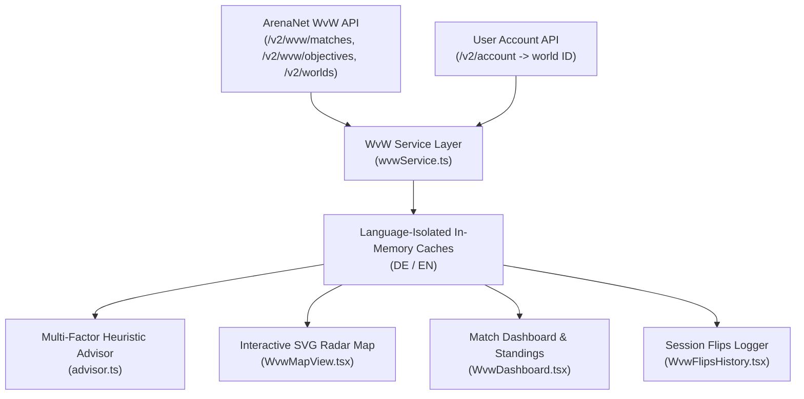
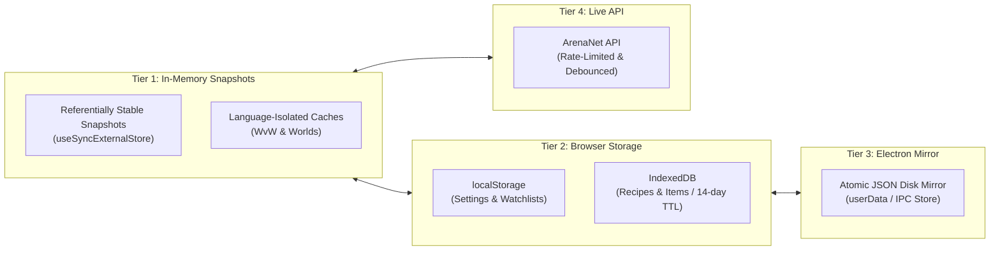

# Data Sources, Architecture & Data Limitations

This document describes the complete data acquisition architecture, data source classifications, algorithmic estimation models, caching strategies, and operational constraints of the **Omnitria** Guild Wars 2 In-Game Overlay.

---

## 1. Data Classification & Source Tiers

All data within Omnitria is strictly partitioned into distinct source classes and labeled transparently across the user interface:

| Class | UI Badge | Source | Description & Usage |
|---|---|---|---|
| **Official Content** | `API` | Official ArenaNet API (`api.guildwars2.com/v2`) | Item definitions, tooltips, official crafting recipes, achievement categories, and icon render URLs. |
| **Account Progress** | `Account` | Authenticated endpoints (`/v2/account/*`) | Material storage, bank tabs, shared inventory slots, character bags, discipline ratings, and live achievement states. |
| **Market Data** | `API` | `/v2/commerce/prices` | Real-time buy orders (instant sell) and sell listings (instant buy) from the Black Lion Trading Post. |
| **World vs. World** | `WvW / API` | `/v2/wvw/*` & `/v2/worlds` | Live match scores, points per tick (PPT), objective ownership, RI timers, server names, and team assignments. |
| **Community Data** | `Community` | Vendored dataset [`crafty_legend`](https://github.com/PieOrCake/crafty_legend) (MIT License) | **Mystic Forge** recipe graphs and item acquisition channels (world exploration, karma vendors, dungeon tokens). |
| **Calculated Engine** | `Calculated` | Domain engine (`src/domain/`) | Net material demand, aggregated Bills of Materials (BOM), leveling step routes, heuristic WvW priority scores, and rotation countdowns. |

---

## 2. ArenaNet API Endpoints & Permissions Matrix

Omnitria communicates directly with official ArenaNet API servers without intermediary relay proxies or third-party collection servers.

### 2.1 Authenticated Account Endpoints (Read-Only)

| Feature | API Endpoint | Required Scope | Fallback Behavior if Scope Unchecked / Guest Mode |
|---|---|---|---|
| **Base Account Sync** | `/v2/account` | `account` | Guest Mode: Overlay functions without personal account linkage. |
| **Achievements Progress** | `/v2/account/achievements` | `progression` | Displays static achievement catalogue with 0% progress. |
| **Daily Boss Completions** | `/v2/account/worldbosses` | `progression` | Boss completion checkmarks must be marked manually. |
| **Map Chest Completions** | `/v2/account/mapchests` | `progression` | Map chest completion states remain unmarked. |
| **Material Storage** | `/v2/account/materials` | `inventories` | Bills of Materials (BOM) do not subtract owned raw materials. |
| **Bank Tabs** | `/v2/account/bank` | `inventories` | Bank items are omitted from inventory deduction pools. |
| **Shared Inventory** | `/v2/account/inventory` | `inventories` | Shared slot items are omitted from inventory deduction pools. |
| **Characters & Bags** | `/v2/characters?ids=all` | `characters` (+ `inventories`) | Character bags omitted; discipline ratings selected manually. |
| **Currencies & Wallet** | `/v2/account/wallet` | `wallet` | In-game currency balances (laurels, astral acclaim) hidden. |
| **Learned Recipes** | `/v2/account/recipes` | `unlocks` | Recipe Book displays all recipes as unlearned; only `AutoLearned` active. |
| **Legendary Armory** | `/v2/account/legendaryarmory` | `unlocks` | Owned legendary weapons are not automatically marked as crafted. |
| **WvW Home World Detection** | `/v2/account` (`world` field) | `account` | Defaults to Red team; player selects active team manually. |

### 2.2 Public Endpoints (No API Key Required)

| Module | API Endpoint | Cache Strategy | Purpose |
|---|---|---|---|
| **WvW Matches** | `/v2/wvw/matches` | 30s Polling / In-Memory | Live match scores, victory points, kills, deaths, maps, and objectives. |
| **WvW Objectives** | `/v2/wvw/objectives?ids=all` | Persistent (14-day TTL) | Static coordinates, objective types (Camps, Towers, Keeps, SM), and sectors. |
| **World Names** | `/v2/worlds?ids=all` | Persistent (14-day TTL) | Resolves numerical world IDs into server names in English and German. |
| **Guild Details** | `/v2/guild/{id}` | In-Memory (Session) | Resolves claiming guild tags and emblems for WvW objectives. |
| **Trading Post Prices** | `/v2/commerce/prices` | 5-Minute In-Memory | Live buy/sell prices for legendary and crafting Bill of Materials. |
| **Item Metadata** | `/v2/items` | IndexedDB (14-day TTL) | Item icons, names, rarities, vendor values, and chat codes. |
| **Crafting Recipes** | `/v2/recipes` | IndexedDB (14-day TTL) | Official recipe inputs, outputs, ratings, and disciplines. |
| **Game Build** | `/v2/build` | On Startup | Detects new Guild Wars 2 game builds to invalidate stale item/recipe caches. |

---

## 3. World vs. World (WvW) Architecture

The WvW Tactical Assistant operates as a dedicated real-time module combining public API streams with an algorithmic heuristic engine.

### 3.1 Data Ingestion & Language Isolation
- **Background Polling:** Active matches are queried every 30 seconds via `startWvwPolling(matchId, 30000)`.
- **Language-Isolated Caching:** To prevent bilingual cache poisoning during instant English/German toggling, static objectives and world maps are stored in isolated memory partitions:
  - `inMemoryObjectivesDe` vs. `inMemoryObjectivesEn`
  - `inMemoryWorldsDe` vs. `inMemoryWorldsEn`
- **Automatic Home Team Detection:** Cross-references the player's account `world` ID against the active match's `all_worlds` table (identifying primary host worlds and linked guest worlds) to auto-select the player's team (`Red`, `Blue`, or `Green`).

### 3.2 Algorithmic Objective Scoring Heuristic
Every non-friendly objective is evaluated every tick across multi-dimensional criteria to yield an actionable priority score (0–100):

$$\text{Priority} = \left( \text{BaseValue} \times W_{\text{strategic}} + \text{TierFactor} \times W_{\text{tier}} + \text{LeaderBonus} \times W_{\text{curb}} - \text{DistPenalty} \times W_{\text{dist}} \right) \times \text{RI\_Multiplier}$$

1. **Righteous Indignation (RI) Immunity Multiplier:**
   - Active RI (5-minute buff post-capture): Objective is invulnerable. Score is penalized by **90%** ($\text{RI\_Multiplier} = 0.10$, capped at 25) to prevent wasted siege deployments.
   - RI Expired: Full scoring unlocked ($\text{RI\_Multiplier} = 1.0$).
2. **Strategic PPT Value:**
   - Stonemist Castle (+12 PPT base / +24 fortified), Keeps (+8/+16 PPT), Towers (+4/+8 PPT), Camps (+2/+4 PPT).
3. **Upgrade Tier Decay:**
   - Freshly flipped T0 objectives (+15% vulnerability window) receive a capture bonus before defensive siege and waypoint upgrades mature.
4. **Leader Curbing Momentum:**
   - Objectives held by the current 1st-place match leader receive dynamic score increases to curb runaway victory point deficits.
5. **Tactical Strategy Presets:**
   - **`Balanced`**: Default weight distribution across strategic value, defense, and roamer opportunities.
   - **`Aggressive`**: Maximizes high-PPT capture recommendations and leader curbing.
   - **`Territorial`**: Prioritizes home borderland defense, asset reclamation, and contest recovery.
   - **`Roamer`**: Filters out fortified keeps in favor of quick camp flips, sentries, and skirmish participation refreshers.

---

## 4. Event Timers & Meta-Event Rotation Schedule

### 4.1 Deterministic Second-by-Second Rotation Model
Tyria's World Boss and Expansion Meta-Event rotations follow a strictly deterministic, periodic **2-hour schedule** anchored to UTC midnight:

$$\text{CycleOffset} = (\text{CurrentTime}_{\text{UTC}} \pmod{7200\text{ seconds}})$$

- **Zero Desync & Zero API Lag:** Rotation calculations run 100% locally on your machine without querying external websites or web scrapers.
- **Coverage:** Full scheduling across all game eras:
  - *Core World Bosses:* Tequatl, The Shatterer, Triple Trouble, Claw of Jormag, Shadow Behemoth, etc.
  - *Expansion Metas:* Heart of Thorns, Path of Fire, End of Dragons, Secrets of the Obscure, Janthir Wilds, and Visions of Eternity.
  - *Orr Temple Metas:* **Cathedral of Zephyrs (Dwayna)** and **Cathedral of Eternal Radiance (Lyssa)** in Malchor's Leap.

### 4.2 In-Game Chat Callout Protocol
- Waypoint chat codes (e.g. `[&BLcCAAA=]` for Dwayna, `[&BKcCAAA=]` for Lyssa) are encoded according to ArenaNet's binary chat link specification (`0x04` waypoint header + 32-bit map coordinate ID + null terminator, base64 encoded).
- Clicking the chat button copies the formatted broadcast directly into the Windows clipboard and sends an IPC event to play an audio confirmation chime.

---

## 5. Crafting, Recipes & Legendary Armory Architecture

### 5.1 Absence of Mystic Forge Recipes in Official API
The official ArenaNet API **does not provide an endpoint for Mystic Forge recipes** (`/v2/recipes/search?output=…` returns 404/empty for legendary weapons).
- **Solution:** Omnitria utilizes an independently verified open-source dataset by PieOrCake (commit `8b674229`), pruned strictly to legendary weapon component graphs.
- **Transparency:** Weapons without a verified recipe in the dataset (e.g. newly released weapons) are explicitly marked in the UI as *“Recipe not yet recorded”*, avoiding synthetic data or unverified guesses.

### 5.2 Algorithmic Crafting Level Progression (0–500)
The GW2 API exposes neither current character XP within a rank nor the XP granted per recipe execution.
- **Community XP Decay Model:**
  $$\text{RanksPerCraft} = \text{Multiplier} \times \left(1 - \frac{\text{CurrentRank} - \text{RecipeRating}}{\text{Span}}\right)$$
  - Standard crafts grant ~1.0 rank at rating, decaying to 0 across a 25-to-50 rank span.
  - Discovery crafts include an empirical **+100% to +200% bonus XP multiplier**, prioritizing high-yield discovery recipes during leveling route calculation.
- **Known Vendor Pricing Database:** Standardized prices for vendor-exclusive Master Craftsman ingredients (flour, yeast, water, salt, tin, charcoal, Icy Runestones at 1g) are integrated via `KNOWN_VENDOR_PRICES` to avoid unpriced false-positive warnings.

### 5.3 Stochastic Yield Modeling (Mystic Clovers)
Mystic Clover crafting in the Mystic Forge is governed by RNG probability tables:
- Expected value calculation applies the community-established average success rate of **31%** ($\text{yield} = 0.31$, requiring ~77 crafting attempts per 77 clovers). All derived material quantities and costs are labeled explicitly as estimates.

---

## 6. Caching, Persistence & Performance

Omnitria implements a 4-tier storage hierarchy to ensure instant sub-millisecond view transitions and strict compliance with ArenaNet API rate limits:

1. **Tier 1: Referentially Stable In-Memory Snapshots (`useSyncExternalStore`)**
   - WvW service snapshots, account progression, and event stores expose immutable snapshot references. Re-renders only trigger when underlying data actually changes, eliminating CPU spikes during 30s background polls.
2. **Tier 2: IndexedDB Persistent Caching**
   - Heavy static datasets (full recipe catalog `recipes:v1` and item definitions `items:de:v1` / `items:en:v1`) are stored compressed in IndexedDB. Cached data is checked against `/v2/build` on application launch and reloaded only when ArenaNet deploys a new game build.
3. **Tier 3: Atomic Electron Disk Mirror**
   - Personal checklists, pin states, and custom weights are mirrored to an atomic JSON file in the Electron `userData` directory via IPC (`store-read` / `store-write`), preventing data loss during unexpected crashes or Windows restarts.
4. **Tier 4: Trading Post Rate Limiting**
   - Market prices (`/v2/commerce/prices`) utilize a 5-minute memory cache buffer to respect ArenaNet API guidelines and avoid HTTP 429 throttling.
5. **Debounced Disk Logging:**
   - Electron main process logs are batched in memory and flushed asynchronously every 500ms or 25 log entries, preventing disk I/O bottlenecks during rapid user interactions.

---

## 7. Legal & Safety Notice

- **Strictly Read-Only:** Omnitria never requests write permissions, password credentials, or payment information.
- **Zero Game Modification:** Omnitria does not hook into Guild Wars 2 memory, inject DLLs, inspect process handles, or modify game binaries. It operates strictly as an external desktop window overlay adhering to the official ArenaNet User Agreement and Third-Party Program Guidelines.
