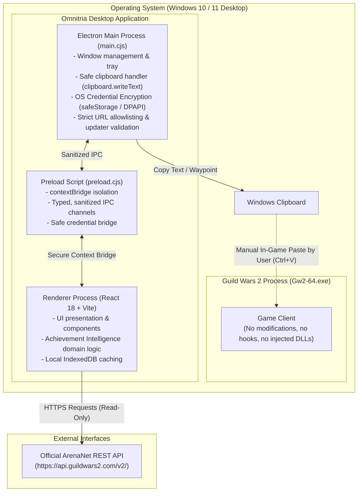

# ArenaNet Terms of Service (ToS) Compliance, Security & Architecture Guide

This document provides a comprehensive technical and policy analysis of **Omnitria** regarding its compliance with the **ArenaNet User Agreement**, **Rules of Conduct**, and official **ArenaNet Third-Party Program Policy**.

> **Important Notice:**  
> **Omnitria is designed to minimize risk under ArenaNet's published third-party-program guidelines. It has not been reviewed, approved, or endorsed by ArenaNet. Use at your own risk.**  
> Omnitria is an independent community project and is **neither reviewed, certified, nor endorsed by ArenaNet or NCsoft**.  
> No third-party program can be declared unconditionally "ban-safe" or "guaranteed rule-compliant". The use of any third-party tool is always at the player's own risk. This document transparently explains the technical architecture, data sources, and safeguards implemented to minimize risks.

---

## 1. Project Scope

### What is Omnitria?
Omnitria is an open-source, external desktop companion and HUD overlay for **Guild Wars 2**. It is designed to grant players convenient in-game access to publicly available game information, achievement guidance, and personal read-only account data without requiring alt-tabbing or navigating external browsers.

### Core Modules
1. **Event & World Boss Timers (`Events`):** Local calculation of Tyria's fixed, deterministic 2-hour UTC rotation schedule across Core Tyria, Expansions, Living World seasons, and The Icebrood Saga with fast-travel waypoint codes.
2. **Account Inventory, Characters & PvE Progression Hub (`Inventory & PvE Hub`):**
   - **Account-Wide Item Search:** Searches items across Material Storage (`/v2/account/materials`), Bank (`/v2/account/bank`), Shared Inventory (`/v2/account/inventory`), Character Bags (`/v2/characters?ids=all` and `/v2/characters/:id/inventory`), and Equipped Gear without double-counting.
   - **Characters & Bags Overview:** Displays character level, profession, race, playtime, active crafting disciplines, bag slot utilization, and equipped gear.
   - **PvE Progression Hub:** Consolidates tracked Legendary projects with next crafting steps, deduplicated multi-goal material planning, active crafting disciplines, pinned achievements, and key wallet currencies.
3. **Achievement Intelligence & Decision Support (`Achievements`):**
   - **Best Next Achievement Hero Showcase:** Prominently highlights the highest-impact upcoming achievement with transparent mathematical scoring and explainable justifications.
   - **Recommendation Strategies:** Five distinct views for player choice: *Best Efficiency*, *Quick Wins*, *Highest Reward*, *Continue Progress*, and *Achievement Categories*.
   - **Transparent AP & Cap Tracking:** Accurate tiered AP calculations, repeatable cycle tracking, and explicit reward-cap enforcement (e.g. *Agent of Entropy* 250 AP cap).
   - **Guest Browsing Mode:** Fully accessible public achievement catalog browsing without requiring an account or API key.
4. **Crafting & Leveling Planner (0–500) (`Crafting`):** Algorithmic lowest-cost route calculation based on community XP progression formulas, live Black Lion Trading Post prices, and automated per-location inventory deduction.
5. **Legendary Armory & Mystic Forge Trees (`Legendary`):** Hierarchical breakdown of legendary weapon recipes and component materials, supporting live material valuations and per-location inventory deductions via API keys.
6. **Settings & Secure Storage (`Settings`):** Local configuration with OS-level credential encryption (`safeStorage` / Windows DPAPI), language toggles (German/English), and click-through controls.

*Note on WvW:* All World vs. World (WvW) tactical recommendations, match polling, momentum analysis, objective scoring, and WvW views have been completely removed from Omnitria to eliminate gameplay-advantage ambiguity under ArenaNet policies.

### Target Audience
The tool is intended for casual players, veterans, achievement hunters, and crafters who want routine game data (timers, achievement routes, inventory locations, recipes, waypoints) presented cleanly and conveniently above or alongside their game screen.

---

## 2. Technical Architecture

Omnitria is built on Electron with a strictly separated architecture (Chromium Renderer and Node.js Main Process) that runs completely isolated from the game client process:

### Technical Security Characteristics
- **Process Isolation:** Omnitria runs as an external operating system process. It does not inspect or manipulate the process memory (`ReadProcessMemory` / `WriteProcessMemory`) of `Gw2-64.exe`.
- **Zero DLL Injection or Graphics Hooking:** Omnitria does not inject dynamic link libraries (`.dll`) or hook into DirectX/Vulkan graphics pipelines (`d3d11.dll`, `dxgi.dll`).
- **Standard Desktop Compositing:** Overlay behavior is achieved exclusively through native Windows desktop window flags (`alwaysOnTop: true`, transparent frameless window).
- **Click-Through Mode (`[F10]`):** When Click-Through is enabled, Omnitria applies the Win32 window style `WS_EX_TRANSPARENT`, directing Windows to forward mouse clicks straight through to the underlying application.
- **Credential Protection:** API keys are encrypted at rest using OS-level DPAPI via Electron's `safeStorage`. API keys are never exposed in error messages, logs, crash reports, or exported files.
- **Electron Hardening:**
  - `contextIsolation: true` and `nodeIntegration: false` prevent direct Node.js access from renderer contexts.
  - Strict `setWindowOpenHandler` blocks unauthorized popups and routes allowlisted external links to the user's default browser.
  - `will-navigate` listeners block unauthorized navigation within the overlay window.
  - Auto-update downloads are strictly constrained to verified GitHub release domains.

---

## 3. Data Sources

Omnitria relies exclusively on information that is either publicly known or retrieved through official interfaces:

| Data Category | Data Source | Technical Mechanism | Known Constraints & Boundaries |
|---|---|---|---|
| **Event Rotation Timers** | Local deterministic calculation | Computed against Tyria's fixed, public 2-hour UTC rotation cycle | Does not dynamically detect individual map instance/IP progression states. |
| **Achievement Definitions** | ArenaNet REST API (`/v2/achievements`, `/v2/achievements/categories`, `/v2/achievements/groups`) | Public JSON endpoints cached locally in IndexedDB | Static game definitions; updated as new content releases. |
| **Account Achievements** | Authenticated ArenaNet API (`/v2/account/achievements`) | Read-only requests authenticated with user's personal API key (`account` + `progression` scopes) | Read-only account progress; cached locally with cache-busting refresh button. |
| **Worlds & Server Names** | ArenaNet REST API (`/v2/worlds`) | Public endpoint resolving world IDs to localized server names | Static world metadata; no server capacity data. |
| **Trading Post Prices** | ArenaNet REST API (`/v2/commerce/prices`) | Public market prices cached locally for 5 minutes | Slight server caching delay (typically 1–5 minutes). |
| **Account, Inventory & Characters** | Authenticated ArenaNet API (`/v2/account/*`, `/v2/characters`) | Read-only requests authenticated with user's personal API key | Read-only by design. Cannot move items, execute trades, delete items, or access account credentials. |
| **Mystic Forge Recipes** | Open-source community dataset (`crafty_legend`) | Local JSON graph files pruned to legendary weapons | Static offline snapshot; newly introduced recipes must be manually updated. |

### Data Explicitly NOT Available or Used
- **No Game Memory Inspection:** Zero reading of entity arrays, character coordinates, health pools, or memory offsets.
- **No Player or Zerg Radar:** Omnitria does not and cannot track player locations, combat actions, or stealth states.
- **No Network Packet Sniffing:** Zero packet interception or socket-level protocol decoders.
- **No WvW Polling:** All historical WvW match and objective polling endpoints (`/v2/wvw/matches`, `/v2/wvw/objectives`) have been eliminated.

---

## 4. Game Interaction & Input Architecture

### Zero Input Automation
ArenaNet's Third-Party Program Policy and Macro Policy strictly prohibit automation that executes multi-action gameplay sequences or acts without direct, deliberate player input (*"one keypress = one combat action"*).

Omnitria enforces the following architecture:
1. **No Automated Chat Opening:** Omnitria does not send keystrokes to the game client.
2. **No Automated Text Insertion or Enter Keys:** Legacy automation helpers (such as Windows Script Host, VBScript `gw2_send.vbs`, or `SendKeys` simulating `Enter -> Ctrl+V -> Enter`) have been **completely eliminated**.
3. **Explicit Clipboard-Only Workflow:**
   - Clicking a waypoint code, item chat link, or callout button exclusively places the formatted text into the Windows clipboard via Electron's native `clipboard.writeText`.
   - The user interface immediately displays clear confirmation toast feedback (*"Copied to clipboard! Paste in-game with [Enter] + [Ctrl+V]"*).
   - The player always retains full control over when to open in-game chat, paste the content, and press Enter.
4. **No Background Input Loops or Macros:** The codebase contains zero timers, loops, or background processes that simulate keyboard or mouse actions in the operating system.

---

## 5. Achievement Intelligence & Informational Decision Support

### Purpose & Design
The Achievement Intelligence module serves as a pure decision-support tool. It assists players in navigating the vast Guild Wars 2 achievement catalog by organizing public metadata and personal progress into actionable, transparent recommendations.

### Core Capabilities
- **Explainable Recommendation Scoring:**  
  Recommendations are generated through transparent arithmetic functions based on:
  - Remaining obtainable Achievement Points (AP).
  - Current completion percentage.
  - Remaining objective count.
  - Objective-to-reward efficiency ratio.
  - Repeatable reward caps.
  Omnitria does **not** employ opaque AI hallucinations or fabricated completion times. Every recommendation is accompanied by a human-readable justification (e.g. *"Recommended because you are at 85% completion with 15 AP remaining"*).
- **Five Distinct Recommendation Strategies:**  
  Players can switch between strategies according to their personal play style:
  1. *Best Next:* Multi-factor balance of obtainable AP, progress proximity, and efficiency.
  2. *Best Efficiency:* Highest AP yield per objective requirement.
  3. *Quick Wins:* Achievements closest to completion (fewest remaining steps).
  4. *Highest Reward:* Highest absolute obtainable AP remaining.
  5. *Continue Progress:* Active partially completed achievements.
- **Capped & Repeatable Achievement Accuracy:**  
  Special care is taken with repeatable achievements like *Agent of Entropy* (ID: 439). The engine verifies earned AP against the official `pointCap` (e.g. 250 AP) and reports `obtainableAp = 0` once the cap is met, preventing deceptive recommendations.
- **Guest Browsing Without API Key:**  
  All public achievement descriptions, tiers, categories, and rewards can be browsed without connecting an ArenaNet account. Personal progress sync requires an API key with `account` and `progression` permissions.
- **Decoupled Standalone Usability:**  
  The achievement tracker, inventory search, and crafting calculators function completely independently of an active game process. Players can organize goals while offline.

---

## 6. Risk Assessment & Remaining Risks

We categorize compliance and technical risk into three distinct tiers:

### A. Technically Standard-Compliant / Low Risk
- **Rotation Timers, Achievement Tracker, Inventory Search & Calculators:** Purely informative mathematical and indexing models derived from public rotation data, local metadata, and official read-only API endpoints without game interaction.
- **Read-Only REST API Ingestion:** Standard HTTP queries conforming to ArenaNet rate limits and local caching guidelines.
- **Manual Clipboard Copying:** Placing text into the OS clipboard is a standard system utility action that involves zero game process tampering.
- **Elimination of WvW Tactical Modules:** With the complete removal of WvW match polling and tactical suggestions, the previous area of interpretative concern regarding competitive advantage has been resolved.

### B. Areas Subject to Interpretation
- **Persistent Desktop Overlay Window:**  
  Frameless desktop overlays are widely used and tolerated across the gaming ecosystem (e.g., Blish HUD, Discord, OBS), but they remain external overlays rather than native game features. Players can run Omnitria in a standalone window if preferred.

### C. Open Questions That Only ArenaNet Can Authoritatively Answer
1. Does ArenaNet intend to offer native in-game API-driven overlay hooks in future client updates?
2. Does ArenaNet have specific guidelines for desktop overlay HUD layouts relative to the game client?

---

## 7. Official Review & Approval Status

- **No Official Approval:** Omnitria is neither reviewed, certified, nor endorsed by ArenaNet.
- **ArenaNet Policy on Third-Party Tools:** ArenaNet does not officially validate or certify third-party software. Their standing stance is: *“Use of any third-party application is at your own risk.”*
- **No Absolute Immunity Guarantee:** Neither the developers of Omnitria nor this guide can guarantee that ArenaNet will not alter policies or exercise enforcement discretion in the future.
- **Mandated Disclaimer:** Omnitria is designed to minimize risk under ArenaNet's published third-party-program guidelines. It has not been reviewed, approved, or endorsed by ArenaNet. Use at your own risk.

---

## 8. Compliance-Relevant Changelog

### Version 0.2.0 (Achievement Intelligence, WvW Deprecation & Secure Storage)
- **Complete WvW Removal:**
  - Removed all WvW-specific UI components, navigation buttons, map views, objective detail drawers, and settings modals.
  - Removed WvW tactical recommendations, match momentum heuristics, objective scoring, and background polling loops.
  - Deleted obsolete WvW tests, localization strings, and screenshots.
- **Achievement Intelligence Section:**
  - Implemented 5 recommendation strategies (Best Efficiency, Quick Wins, Highest Reward, Continue Progress, Categories) and central Best Next Achievement hero card.
  - Transparent mathematical ranking with explainable justifications (DE/EN).
  - Explicit handling of repeatable caps (e.g. Agent of Entropy 250 AP limit).
  - Unauthenticated guest browsing support for public achievement catalog.
- **OS-Level Credential Protection:**
  - Integrated Electron `safeStorage` (Windows DPAPI) for encrypting ArenaNet API keys at rest.
  - Plaintext fallback sanitization upon successful encryption.
  - API keys completely redacted from console logs, crash dumps, and error toasts.

### Version 0.1.8 (Account Inventory & PvE Expansion)
- **Account-Wide Item Search & PvE Progression Hub:**
  - Added read-only account inventory indexing across `/v2/account/materials`, `/v2/account/bank`, `/v2/account/inventory`, and `/v2/characters` without exposing API keys in logs, UI screenshots, or error messages.
  - Added clear permission diagnostics when `inventories` or `characters` scopes are missing on an API key.

### Version 0.1.7 (Compliance & Security Overhaul)
- **Removal of Input and Keystroke Simulation:**
  - Removed `sendTextToGw2`, VBScript generation (`gw2_send.vbs`), `WScript.Shell`, and `child_process.exec` from `electron/main.cjs`.
  - Converted all chat and waypoint interactions to explicit, manual clipboard copying (`clipboard.writeText`).
  - Defused legacy IPC routes (`gw2-send-chat`, `gw2-teleport-waypoint`) to safely copy to clipboard only.
- **Electron Security Hardening:**
  - Added strict URL allowlisting for external links via `shell.openExternal`.
  - Constrained auto-updater package downloads strictly to official GitHub release URLs.
  - Implemented window navigation locks (`will-navigate`) against unauthorized URL transitions.
- **Documentation Overhaul:**
  - Removed all unverified claims regarding absolute ban immunity, 100% guarantees, or official ArenaNet endorsement.
  - Restructured compliance documentation into 8 comprehensive, objective sections.
